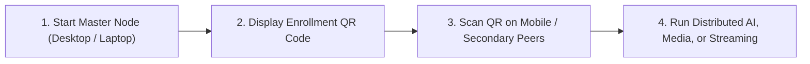

# Universal Mobile Compute Fabric (UMCF) — User Guide

Welcome to the **Universal Mobile Compute Fabric (UMCF)**. UMCF allows you to link your phones, tablets, laptops, desktops, servers, and web browsers into a private, encrypted peer-to-peer compute mesh. With UMCF, you can run large AI models that exceed any single device's memory, accelerate video transcoding and GPU rendering across your devices, and stream desktop applications or games at up to 120 FPS with ultra-low latency.

---

## 1. Supported Platforms & System Requirements

| Platform | Minimum OS Version | Recommended Hardware | Supported Compute Backends |
| :--- | :--- | :--- | :--- |
| **Android** | Android 11 (API 30)+ | 6 GB+ RAM, `aarch64` SoC (Snapdragon / Tensor / Dimensity) | Vulkan 1.2+, QNN / NNAPI, ARM NEON SIMD |
| **iOS / iPadOS** | iOS 16.0+ | iPhone 13+ / M-series iPad | Apple Metal, Accelerate / AMX |
| **Windows** | Windows 10 (21H2) / 11 | 8 GB+ RAM, `x86_64` or `ARM64` | NVIDIA CUDA 12+, DirectX 12, Vulkan, AVX2 |
| **Linux** | Kernel 5.15+ (glibc 2.35+) | 4 GB+ RAM, `x86_64` or `aarch64` | NVIDIA CUDA, AMD ROCm, Vulkan, AVX2/NEON |
| **macOS** | macOS 13 (Ventura)+ | Apple Silicon (`M1`/`M2`/`M3`/`M4`) or Intel | Apple Metal (Unified Memory), Accelerate |
| **Web Browser** | Chrome 118+, Edge 118+, Firefox 125+ | WebGPU & WebCodecs enabled browser | WebGPU, WebAssembly SIMD128 |

---

## 2. Quick Start: 60-Second Cluster Onboarding



### Step 1: Initialize Your First Node (Master / Hybrid)
On your primary desktop, laptop, or server, launch the **UMCF Desktop App** or run the CLI daemon:

```bash
# Initialize local Ed25519 identity and create a new personal cluster
umcf init --cluster-name "home-fabric"

# Start the node in Hybrid (Master + Worker) mode
umcf up --role hybrid
```

### Step 2: Generate a One-Scan Enrollment QR Code
In the UMCF Desktop/Mobile UI, click **"Add Device to Fabric"**, or run in your terminal:

```bash
umcf enroll token --ttl 120s --qr
```
This prints an ASCII QR code directly in your terminal alongside an `umcf://enroll?...` URI valid for 120 seconds.

### Step 3: Join from Your Phone, Tablet, or Second Computer
- **On Android / iOS**: Open the **UMCF Mobile App**, tap **"Scan Cluster QR"**, and point the camera at your desktop screen.
- **On Another Desktop / Server**: Run:
  ```bash
  umcf join "umcf://enroll?c=clu_01938a7f...&n=e4f9...&pk=b4f2...&lan=192.168.1.42:4433&sig=8d1c..."
  ```
- **Automatic Local Discovery**: Once enrolled, devices on the same Wi-Fi or Ethernet LAN automatically discover each other via zero-configuration mDNS (`_umcf._udp.local`) even if your internet connection is completely unplugged.

### Step 4: Verify Your Cluster Mesh
Check connected nodes, hardware capabilities, and link latencies:

```bash
umcf status
```

Example output:
```text
Cluster ID: clu_01938a7f9c207b8291a4  |  Lease Epoch: 4  |  Mode: LAN Direct + WAN Standby
---------------------------------------------------------------------------------------------------------
NODE ID                  NAME             ROLE    BACKEND        ALLOC RAM   THERMAL   LINK RTT   STATUS
umcf1_7q9x2m4k8p1w...    workstation-pc   Hybrid  CUDA (RTX4070) 11.5 GiB    Nominal   0.0 ms     Ready
umcf1_3m8n1p5v9x2z...    macbook-air-m3   Worker  Metal (GPU)    10.2 GiB    Nominal   1.4 ms     Ready
umcf1_9k2j4h6g8f0d...    pixel-8-pro      Worker  Vulkan (Adreno) 4.1 GiB    Nominal   2.1 ms     Ready
---------------------------------------------------------------------------------------------------------
Total Cluster Allocatable Memory: 25.8 GiB across 3 nodes
```

---

## 3. Core Workflows

### 3.1 Running Distributed AI Inference (LLMs)
UMCF partitions large GGUF language models by transformer layer ranges across your devices so you can run models that exceed any single device's VRAM, or combine multiple devices for higher throughput.

#### Using the CLI:
```bash
# Import a local GGUF model into the Content-Addressed Storage (CAS) fabric
umcf models import ./Meta-Llama-3.1-8B-Instruct-Q4_K_M.gguf

# Run an interactive chat session across the fabric
umcf ai chat --model llama-3.1-8b-q4km --prompt "Explain how pipeline parallelism works."

# Or start a local OpenAI-compatible API server on port 8080 backed by the cluster
umcf ai serve --port 8080 --model llama-3.1-8b-q4km
```

Now any OpenAI-compatible tool (VS Code extensions, Python `openai` SDK, `curl`) can query your distributed cluster at `http://127.0.0.1:8080/v1/chat/completions`.

#### How Layer Partitioning Works Automatically:
- **Single-Node Fast Path**: If your `workstation-pc` has 12 GB free VRAM and you load a 5 GB model, UMCF automatically runs 100% of the model on `workstation-pc` to avoid unnecessary network hops.
- **Multi-Node Pipeline Split**: If you load a 22 GB model (`Qwen-2.5-32B-Q4_K_M`), UMCF automatically slices layers `0..14` onto `workstation-pc`, layers `15..28` onto `macbook-air-m3`, and layers `29..35` onto `pixel-8-pro`, streaming compact `4 KiB`–`8 KiB` activation tensors over QUIC between stages.

---

### 3.2 Distributed Video Transcoding & GPU Compute
Split heavy video encoding or WGSL shader workloads across every GPU in your fabric:

```bash
# Transcode a 4K recording to AV1/HEVC in parallel across all cluster GPUs
umcf media transcode \
  --input ./raw_recording_4k60.mp4 \
  --output ./encoded_hevc.mp4 \
  --codec hevc \
  --bitrate 15M
```
UMCF splits the input video at keyframe Group-of-Pictures (GOP) boundaries, distributes chunks via BLAKE3 CAS swarming, encodes segments in parallel using hardware codecs (`NVENC`, `VideoToolbox`, `MediaCodec`), and muxes the final container seamlessly.

---

### 3.3 Low-Latency Remote Desktop & Game Streaming
Stream your high-powered Windows/Linux/macOS desktop or specific application window to your phone, tablet, laptop, or browser at up to 1080p/1440p 120 FPS:

```bash
# On the Host PC: Enable streaming host access
umcf stream host --fps 120 --bitrate 30000 --codec hevc --allow-input

# On the Client Device (or select the Host in the Mobile/Web UI):
umcf stream connect umcf1_7q9x2m4k8p1w...
```
- **In-Stream Shortcut Keys**:
  - `Ctrl + Alt + Shift + S`: Toggle real-time Telemetry HUD (`Capture ms`, `Encode ms`, `Network RTT`, `Decode ms`, `Packet Loss %`).
  - `Ctrl + Alt + Shift + Q`: Disconnect stream session.
  - `Ctrl + Alt + Shift + M`: Toggle relative/absolute mouse capture mode.

---

## 4. Managing Mobile Battery, Thermals & Resource Limits

UMCF is engineered to protect your mobile hardware first:
1. **75% Free RAM Hard Cap**: On Android and iOS, UMCF never allocates more than 75% of currently available free memory to prevent background app kills.
2. **Automatic Thermal Cutoff**:
   - **Nominal (`< 38°C`) / Fair (`38–41°C`)**: Full configured worker performance.
   - **Serious (`41–43°C`)**: Automatically scales down thread count and batch concurrency.
   - **Critical (`>= 43°C` battery or `>= 85°C` SoC)**: Immediately drains active tasks to another peer within `< 1.5s` and enters `ThrottledStandby` until the device cools below `39°C` for at least 60 seconds.
3. **Battery Floor**: By default, mobile nodes pause compute participation if unplugged battery drops below **20%** and resume only when charged above **30%** or connected to AC power.

### Customizing Your Device Budget
Adjust limits anytime in the **Settings -> Resource Guard** tab of the app or via CLI:

```bash
# Restrict this device to at most 4 GiB RAM, 4 CPU threads, and require AC charging
umcf config set \
  --max-ram-gb 4.0 \
  --max-cpu-threads 4 \
  --require-charging true \
  --thermal-cutoff-celsius 42.0
```

---

## 5. Troubleshooting & FAQ

### Q1: Why don't my devices see each other on Corporate/Guest Wi-Fi?
Many enterprise, university, or hotel "Guest" Wi-Fi networks enable **AP Client Isolation**, which blocks multicast mDNS (`UDP :5353`) and direct peer-to-peer UDP traffic between devices on the same Wi-Fi.
- **Solution**: Ensure WAN signaling is enabled (`umcf config set --enable-wan true`). UMCF will automatically use the Control Plane (`services/control-plane-cf` or `control-plane-cloudrun`) to attempt STUN hole-punching and seamlessly fall back to an encrypted TURN/DERP relay tunnel within `900ms`.

### Q2: Can I pool two 8 GB phones to run a single unmodified Windows PC game that requires 16 GB VRAM?
**No.** Due to physical network latency ($1\text{--}5\text{ ms}$ over Wi-Fi vs. $0.0001\text{ ms}$ inside a GPU chip), unmodified closed-source 3D games cannot split their per-frame DirectX draw calls across Wi-Fi. Instead:
- **For Games & Interactive Desktop Apps**: Run the game on your most capable PC/console node and use UMCF's **Low-Latency Game Streaming Engine (`umcf-engine-stream`)** to play it on your phone, tablet, or laptop at 120 FPS.
- **For AI Models (LLMs) & Media Rendering**: UMCF **does** pool your devices' memory and compute using **Layer-Partitioned Pipeline Parallelism** and **GOP/Tile Task Splitting**, allowing two 8 GB devices and a laptop to collaboratively run a 16+ GB language model.

### Q3: Exporting a Diagnostic Bundle
If you encounter an issue, generate a redacted diagnostic archive (guaranteed free of private keys or chat prompts):
```bash
umcf diagnostics export --output ./umcf-support-bundle.tar.gz
```
