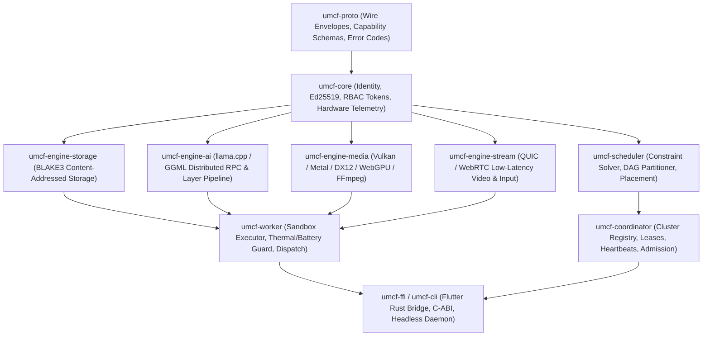

# Universal Mobile Compute Fabric (UMCF) — Component Contracts

> [!NOTE]
> This document specifies the normative interface contracts, data structures, error taxonomies, and runtime invariants for all crates, execution engines, control plane services, and client applications in `g:\ucf`. Every implementation in `crates/*`, `services/*`, and `apps/*` must adhere strictly to these signatures and behavioral guarantees.

---

## 1. Crate Dependency Topology



---

## 2. `umcf-proto` — Wire Protocol & Capability Schemas

**Location**: `crates/umcf-proto`  
**Purpose**: Defines versioned, deterministic wire envelopes serialized via **MessagePack (`rmp-serde`)** or **Bincode** over QUIC streams, and **JSON (`serde_json`)** over Control Plane REST/WebSocket endpoints.

### 2.1 Wire Frame Format (QUIC Stream Framing)
Every message on a reliable QUIC stream is prefixed with a 16-byte fixed header:
```text
 0                   1                   2                   3
 0 1 2 3 4 5 6 7 8 9 0 1 2 3 4 5 6 7 8 9 0 1 2 3 4 5 6 7 8 9 0 1
+-+-+-+-+-+-+-+-+-+-+-+-+-+-+-+-+-+-+-+-+-+-+-+-+-+-+-+-+-+-+-+-+
|         Magic (0x554D = "UM") |  ProtoVer (1) |   Flags       |
+-+-+-+-+-+-+-+-+-+-+-+-+-+-+-+-+-+-+-+-+-+-+-+-+-+-+-+-+-+-+-+-+
|                        MessageType (u16)      |  Reserved(u16)|
+-+-+-+-+-+-+-+-+-+-+-+-+-+-+-+-+-+-+-+-+-+-+-+-+-+-+-+-+-+-+-+-+
|                        PayloadLength (u32, Big-Endian)        |
+-+-+-+-+-+-+-+-+-+-+-+-+-+-+-+-+-+-+-+-+-+-+-+-+-+-+-+-+-+-+-+-+
|                        HeaderCRC32C (u32, Castagnoli)         |
+-+-+-+-+-+-+-+-+-+-+-+-+-+-+-+-+-+-+-+-+-+-+-+-+-+-+-+-+-+-+-+-+
|                        Payload Bytes (0..67,108,864)          |
+-+-+-+-+-+-+-+-+-+-+-+-+-+-+-+-+-+-+-+-+-+-+-+-+-+-+-+-+-+-+-+-+
```

### 2.2 Core Rust Contract Types

```rust
/// Protocol version constant. Rejects mismatched major versions with `ProtoError::UnsupportedVersion`.
pub const UMCF_PROTO_VERSION: u8 = 1;
pub const MAX_CONTROL_FRAME_BYTES: u32 = 65_536;          // 64 KiB hard cap for Control Plane
pub const MAX_DATA_FRAME_BYTES: u32 = 67_108_864;         // 64 MiB hard cap per single Data Plane frame

#[repr(u16)]
#[derive(Debug, Clone, Copy, PartialEq, Eq, Serialize, Deserialize)]
pub enum MessageType {
    HelloHandshake = 0x0001,
    AttestationChallenge = 0x0002,
    AttestationResponse = 0x0003,
    HeartbeatPing = 0x0010,
    HeartbeatPong = 0x0011,
    CapabilityReport = 0x0020,
    JobSubmitRequest = 0x0100,
    JobSubmitAck = 0x0101,
    TaskLeaseAssign = 0x0110,
    TaskStateUpdate = 0x0111,
    TaskPreemptCommand = 0x0112,
    TensorRpcForward = 0x0200,
    TensorRpcResult = 0x0201,
    KvCacheSync = 0x0202,
    CasChunkRequest = 0x0300,
    CasChunkData = 0x0301,
    StreamControl = 0x0400,
    InputEventBatch = 0x0401,
}

#[derive(Debug, Clone, Serialize, Deserialize)]
pub struct WireEnvelope<T> {
    pub version: u8,
    pub message_id: uuid::Uuid,
    pub correlation_id: Option<uuid::Uuid>,
    pub sender_node_id: String,
    pub lease_epoch: u64,
    pub timestamp_unix_ms: u64,
    pub payload: T,
    /// Ed25519 signature over canonical bytes of (version..payload)
    pub signature: [u8; 64],
}
```

### 2.3 Invariants & Error Types
- **Invariants**:
  - `PayloadLength` on Control Plane channels MUST NOT exceed `65,536` bytes.
  - Every `WireEnvelope` mutation or command MUST verify `signature` against the sender's pinned Ed25519 public key before deserializing inner execution parameters.
- **Errors (`ProtoError`)**:
  - `InvalidMagic(u16)`, `UnsupportedVersion(u8)`, `FrameTooLarge { size: u32, limit: u32 }`, `CrcMismatch { expected: u32, actual: u32 }`, `SignatureVerificationFailed`, `CodecError(String)`.

---

## 3. `umcf-core` — Identity, Security & Hardware Telemetry

**Location**: `crates/umcf-core`  
**Purpose**: Provides platform-agnostic cryptographic identity, RBAC capability tokens, dynamic role state machines, and hardware resource profiling.

### 3.1 Interface Contract

```rust
#[derive(Debug, Clone, PartialEq, Eq, Hash, Serialize, Deserialize)]
pub struct NodeId(pub String); // Format: "umcf1_<32-char-base32-blake3>"

#[derive(Debug, Clone, Copy, PartialEq, Eq, Serialize, Deserialize)]
pub enum NodeRole {
    Unenrolled,
    Worker,
    Master,
    Hybrid,
    Draining,
    ThrottledStandby,
}

#[derive(Debug, Clone, Serialize, Deserialize)]
pub struct AcceleratorDescriptor {
    pub device_index: u32,
    pub vendor: AcceleratorVendor, // Nvidia, Amd, Apple, Qualcomm, Intel, Arm, WebGpu
    pub backend: ComputeBackend,   // Cuda, Rocm, Metal, Vulkan, Dx12, Qnn, WebGpu, CpuSimd
    pub model_name: String,
    pub dedicated_vram_bytes: u64,
    pub unified_memory: bool,
    pub fp16_tflops_calibrated: f32,
    pub int4_tok_per_sec_calibrated: f32,
    pub memory_bandwidth_gbps: f32,
    pub supports_kv_offload: bool,
}

#[derive(Debug, Clone, Serialize, Deserialize)]
pub struct ResourceProfile {
    pub node_id: NodeId,
    pub platform: PlatformOs, // Android, Ios, Windows, Linux, MacOs, Web
    pub cpu_arch: CpuArch,    // X86_64, Aarch64, Wasm32
    pub logical_cores: u16,
    pub performance_cores: u16,
    pub total_ram_bytes: u64,
    pub available_ram_bytes: u64,
    pub allocatable_ram_bytes: u64, // Enforces <= 75% of available_ram_bytes on mobile
    pub accelerators: Vec<AcceleratorDescriptor>,
    pub power_state: PowerState,
    pub thermal_state: ThermalState,
    pub network_interfaces: Vec<EndpointCandidate>,
    pub calibration_signature: [u8; 64],
}

#[derive(Debug, Clone, Serialize, Deserialize)]
pub struct PowerState {
    pub on_ac_power: bool,
    pub battery_percent: Option<u8>,
    pub battery_discharge_mw: Option<u32>,
}

#[derive(Debug, Clone, Copy, PartialEq, Eq, PartialOrd, Ord, Serialize, Deserialize)]
pub enum ThermalState {
    Nominal = 0,   // < 38C battery / < 70C die
    Fair = 1,      // 38..41C battery / 70..80C die
    Serious = 2,   // 41..43C battery / 80..85C die (Scale down concurrency)
    Critical = 3,  // >= 43C battery / >= 85C die (Immediate preemption/drain)
}

pub trait IdentityProvider: Send + Sync {
    fn node_id(&self) -> &NodeId;
    fn public_key_bytes(&self) -> [u8; 32];
    fn sign(&self, message: &[u8]) -> [u8; 64];
    fn verify(pubkey: &[u8; 32], message: &[u8], signature: &[u8; 64]) -> Result<(), SecurityError>;
    fn issue_rbac_token(&self, subject: &NodeId, scopes: &[CapabilityScope], ttl_secs: u64) -> Result<String, SecurityError>;
}
```

### 3.2 Invariants & Error Types
- **Invariants**:
  - Private Ed25519 keys never leave `IdentityProvider` in plaintext logs or network payloads (`ZeroizeOnDrop` enforced).
  - `allocatable_ram_bytes` on `Android` and `Ios` MUST NEVER exceed `0.75 * available_ram_bytes`.
  - When `ThermalState == Critical` or `(on_ac_power == false && battery_percent < Some(20))`, the node MUST transition to `NodeRole::Draining` within `500ms`.
- **Errors (`CoreError`)**:
  - `KeystoreAccessDenied`, `InvalidTokenSignature`, `TokenExpired`, `InsufficientScope { required: CapabilityScope }`, `TelemetryProbeFailed(String)`.

---

## 4. `umcf-coordinator` — Cluster Registry, Lease Management & Admission

**Location**: `crates/umcf-coordinator`  
**Purpose**: Manages cluster membership, monotonic `lease_epoch` leadership, heartbeat liveness tracking, and job admission queues.

### 4.1 Interface Contract

```rust
#[async_trait::async_trait]
pub trait ClusterCoordinator: Send + Sync {
    /// Registers or refreshes a peer node in the active cluster registry.
    async fn upsert_node(&self, profile: ResourceProfile, lease_epoch: u64) -> Result<ClusterMembershipAck, CoordinatorError>;

    /// Processes a 1000ms periodic heartbeat from a worker.
    async fn record_heartbeat(&self, heartbeat: WorkerHeartbeat) -> Result<HeartbeatDirective, CoordinatorError>;

    /// Admits a new distributed job DAG and triggers `umcf-scheduler` placement.
    async fn submit_job(&self, job: JobSpec, requester: &NodeId) -> Result<JobHandle, CoordinatorError>;

    /// Queries cluster topology snapshot for scheduler solver.
    async fn snapshot_cluster(&self) -> ClusterSnapshot;

    /// Initiates graceful lease handover when Master enters Draining state.
    async fn handover_leadership(&self, target_node: Option<NodeId>) -> Result<u64, CoordinatorError>;
}
```

### 4.2 Invariants & Error Types
- **Invariants**:
  - **Fencing Token Monotonicity**: Any state-mutating request with `req.lease_epoch < current_lease_epoch` is immediately rejected with `CoordinatorError::StaleLeaseEpoch`.
  - **Heartbeat Eviction**: A worker missing 3 consecutive heartbeats (`3,000ms` on LAN, `6,000ms` on WAN) is marked `Suspect`, and after `5,000ms` (LAN) / `10,000ms` (WAN) its active task leases are revoked and rescheduled.
- **Errors (`CoordinatorError`)**:
  - `StaleLeaseEpoch { current: u64, received: u64 }`, `NodeNotEnrolled(NodeId)`, `ClusterCapacityExceeded`, `JobAdmissionRejected(String)`, `QuorumLost`.

---

## 5. `umcf-scheduler` — Constraint Solver, DAG Partitioner & Placement

**Location**: `crates/umcf-scheduler`  
**Purpose**: Partitions high-level jobs (LLM inference models, video transcodes, compute shaders) into an executable DAG of subtasks and maps them onto heterogeneous nodes to minimize end-to-end latency while respecting memory, thermal, and bandwidth constraints.

### 5.1 Mathematical Cost Model & Interface
For an LLM inference job with $L$ layers, hidden dimension $d$, sequence length $s$, and candidate node chain $P = (n_1, n_2, \dots, n_k)$ where node $n_i$ hosts $\ell_i$ layers ($\sum \ell_i = L$):

$$\text{MemoryRequired}(n_i, \ell_i) = \ell_i \cdot \left(W_{\text{layer}} + 2 \cdot s_{\max} \cdot d_{\text{kv}} \cdot \text{sizeof(KV)}\right) + B_{\text{scratch}} \le \text{AllocatableRAM}(n_i)$$

$$\text{StepLatency}(P) = \max_{\text{pipeline}} \sum_{i=1}^{k} \left( \frac{\ell_i \cdot C_{\text{layer}}}{\text{EffFLOPS}(n_i)} + \frac{\text{ActivationBytes}(s, d)}{\text{Bandwidth}(n_i, n_{i+1})} + \text{RTT}(n_i, n_{i+1}) \right)$$

```rust
pub trait DagScheduler: Send + Sync {
    /// Computes an optimal execution plan assigning DAG stages to cluster nodes.
    fn compute_placement(
        &self,
        job: &JobSpec,
        cluster: &ClusterSnapshot,
        link_matrix: &PeerLinkMatrix,
    ) -> Result<ExecutionPlan, SchedulerError>;

    /// Incrementally repairs an execution plan when a single worker fails or throttles.
    fnIncrementalRebalance(
        &self,
        current_plan: &ExecutionPlan,
        degraded_node: &NodeId,
        cluster: &ClusterSnapshot,
        link_matrix: &PeerLinkMatrix,
    ) -> Result<RebalanceDelta, SchedulerError>;
}
```

### 5.2 Invariants & Error Types
- **Invariants**:
  - **Zero Overcommit**: The sum of assigned task memory footprints on any node $n$ MUST be $\le \text{allocatable\_ram\_bytes}(n)$.
  - **Colocation Preference**: If a single node can fit the entire model/job within its VRAM/RAM and meets the latency SLO, `compute_placement` MUST prefer single-node execution (`k = 1`) over multi-node partitioning whenever network serialization overhead exceeds parallel speedup.
- **Errors (`SchedulerError`)**:
  - `InsufficientClusterMemory { required_bytes: u64, available_bytes: u64 }`, `NoCompatibleBackend { required: ComputeBackend }`, `CyclicDagDetected`, `BandwidthConstraintUnsatisfied`.

---

## 6. `umcf-worker` — Sandbox Executor, Resource Guard & Engine Dispatch

**Location**: `crates/umcf-worker`  
**Purpose**: Manages local task lifecycles, enforces memory/thermal/battery circuit breakers, stages required CAS chunks, and dispatches workloads to the specialized execution engines.

### 6.1 Interface Contract

```rust
#[async_trait::async_trait]
pub trait WorkerRuntime: Send + Sync {
    async fn accept_lease(&self, assignment: TaskLeaseAssignment) -> Result<LeaseAck, WorkerError>;
    async fn execute_stage(&self, lease_id: Uuid, input: StageInputStream) -> Result<StageOutputStream, WorkerError>;
    async fn preempt_task(&self, lease_id: Uuid, reason: PreemptReason) -> Result<TaskCheckpoint, WorkerError>;
    fn current_telemetry(&self) -> WorkerTelemetry;
}
```

---

## 7. Execution Engines (`crates/umcf-engine-*`)

### 7.1 Distributed AI Engine (`umcf-engine-ai` — `llama.cpp` / GGML Integration)
- **Contract**: Executes either a full GGUF model or a contiguous slice of transformer layers `[start_layer..end_layer]` with local KV-cache management and zero-copy QUIC RPC tensor forwarding.
- **Inputs**: `AiStageConfig { model_cas_digest: Blake3Hash, layer_range: Range<u32>, kv_cache_tokens: u32, quantization: QuantType, backend: ComputeBackend }`, plus incoming `TensorPacket { seq_id, pos, shape, dtype, data }`.
- **Outputs**: Outgoing `TensorPacket` (intermediate hidden state for next pipeline node) or `TokenSampleEvent` (if hosting the final LM head layer).
- **Invariants**:
  - Model weights are memory-mapped (`mmap`) directly from the verified CAS store whenever supported by the OS.
  - KV-cache state is keyed by `session_id` and supports prefix checkpointing/eviction.

### 7.2 GPU & Media Compute Engine (`umcf-engine-media`)
- **Contract**: Executes cross-platform GPU compute pipelines (`wgpu` over Vulkan/Metal/DX12/WebGPU) and hardware-accelerated media transcoding (`FFmpeg` / platform codecs).
- **Inputs**: `MediaJobTask { input_cas_hash, codec_profile, segment_pts_range, shader_wgsl_hash }`.
- **Outputs**: `MediaSegmentResult { output_cas_hash, duration_ms, encode_fps, psnr_db }`.
- **Invariants**: WGSL shaders are validated for bounded loop/memory access via `naga` before GPU submission.

### 7.3 Remote Desktop & Game Streaming Engine (`umcf-engine-stream`)
- **Contract**: Captures display/window surfaces (DXGI Desktop Duplication, PipeWire/DRM, ScreenCaptureKit), hardware-encodes H.264/HEVC/AV1 low-latency frames (`Zero-Latency` tuning, intra-refresh), transmits over QUIC Datagrams / WebRTC RTP, and injects authenticated remote input events (`SendInput`, `uinput`, `CGEvent`).
- **Inputs**: `StreamSessionConfig { target_fps: u16, bitrate_kbps: u32, codec: VideoCodec, enable_audio: bool, input_permissions: InputMask }`.
- **Outputs**: Real-time video/audio RTP/QUIC streams + `StreamStats { capture_ms, encode_ms, network_rtt_ms, decode_ms, jitter_ms }`.
- **Invariants**: Input injection MUST be explicitly authorized by the host user and bounded to the streamed window/desktop scope.

### 7.4 Content-Addressed Storage Engine (`umcf-engine-storage`)
- **Contract**: Stores, verifies, and transfers immutable data blobs addressed by their 256-bit **BLAKE3** Merkle tree root hash (`umcf_cas_<hex>`).
- **Chunking**: Files `> 4 MiB` are split into fixed `4 MiB` chunks for parallel multi-peer swarming (BitTorrent/IPFS-style block fetching from multiple LAN/WAN peers simultaneously).
- **Invariants**: Every chunk is verified against its BLAKE3 leaf hash *before* being committed to disk or exposed to an execution engine. Corrupted chunks trigger immediate peer ban/retry.

---

## 8. Control Plane Services & Client Applications

### 8.1 `services/control-plane-cf` (Cloudflare Workers + Durable Objects)
| Endpoint | Method | Auth | Request Payload | Response Payload |
| :--- | :--- | :--- | :--- | :--- |
| `/v1/clusters/:id/enroll` | `POST` | Enrollment Token | `EnrollmentRequest { node_id, pubkey, profile }` | `EnrollmentCert { cluster_id, rbac_jwt, coordinator_endpoints }` |
| `/v1/clusters/:id/signal` | `GET (WS)` | Ed25519 Signed Header + JWT | Bidirectional JSON `SignalEnvelope` (ICE, Heartbeat, Lease) | Real-time cluster events & peer candidate relay |
| `/v1/clusters/:id/topology` | `GET` | RBAC JWT (`cluster:read`) | None | `ClusterTopologyResponse { lease_epoch, master_id, nodes }` |

### 8.2 `services/control-plane-cloudrun` (Google Cloud Run Fallback)
- Mirrors the exact `/v1/clusters/:id/*` REST and WebSocket API surface of `control-plane-cf`.
- Stateless Rust (`axum` + `tokio`) container backed by in-memory state with optional Firestore/Redis persistence, providing seamless failover when Cloudflare edge routes are blocked or unreachable.

### 8.3 `apps/mobile-desktop` (Flutter Unified Client)
- **Target Platforms**: Android, iOS, Windows, Linux, macOS.
- **Bridge**: Communicates with `umcf-ffi` via `flutter_rust_bridge` v2 asynchronous zero-copy streams (`Stream<ClusterSnapshot>`, `Stream<InferenceToken>`, `TextureRegistry` for zero-copy video streaming).
- **Key Views**: Cluster Mesh Topology Radar, One-Scan QR Enrollment, Distributed AI Chat & Model Manager, Remote Desktop/Game Stream Viewer, and Thermal/Battery Resource Budget Sliders.

### 8.4 `apps/web-dashboard` (Svelte 5 + WebGPU + WebTransport Client)
- **Target Platforms**: Modern Chromium/Firefox/Safari browsers.
- **Capabilities**: Real-time observability dashboard, job submission console, remote stream viewer (via `WebCodecs` + `WebRTC`), and optional browser-based WebGPU worker participation (`umcf-wasm`).
