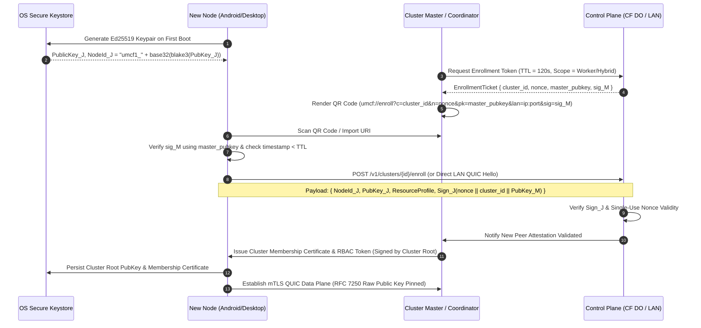
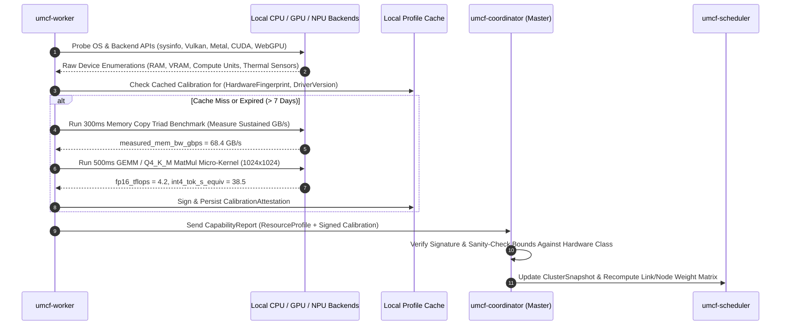
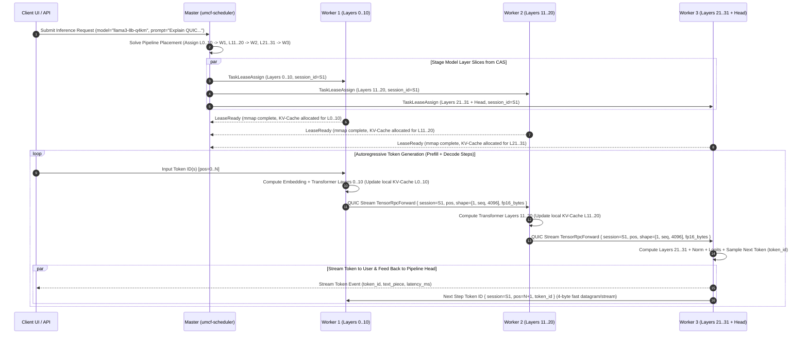
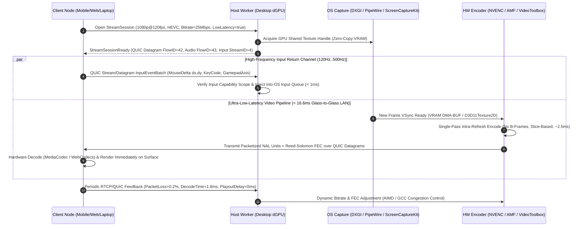
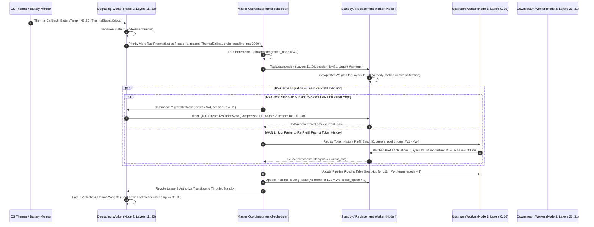

# Universal Mobile Compute Fabric (UMCF) — End-to-End Data Flows

> [!NOTE]
> This document details the six canonical runtime data flows of UMCF, including protocol sequence diagrams, wire packet structures, cryptographic handshakes, and failure recovery transitions.

---

## Flow 1: Device Identity Generation, QR Code Enrollment & Mutual Attestation

### 1.1 Overview
When a new device boots UMCF for the first time, it generates an unexportable Ed25519 identity keypair in the platform keystore. To join an existing user fabric without typing passwords or exposing open ports, the existing Master/Coordinator displays a short-lived QR code (or shareable URI `umcf://enroll?...`) containing the cluster's root public key, one-time cryptographic nonce, LAN/WAN endpoints, and expiration timestamp.

### 1.2 Sequence Diagram



### 1.3 Enrollment Payload Schema
```json
{
  "version": 1,
  "cluster_id": "clu_01938a7f9c207b8291a4",
  "enrollment_nonce": "e4f901a28b7c6d5e4f3a2b1c0d9e8f7a",
  "master_node_id": "umcf1_7q9x2m4k8p1w3v5n6b8c0d2f4g6h8j0k",
  "master_pubkey_ed25519": "b4f2...9a01",
  "lan_candidates": ["192.168.1.42:4433", "[fe80::1a2b:3c4d]:4433"],
  "wan_control_url": "https://signal.umcf.internal/v1/clusters/clu_01938a7f9c207b8291a4",
  "expires_at_unix_ms": 1762756800000,
  "master_signature": "8d1c...3e7f"
}
```

---

## Flow 2: LAN mDNS Discovery vs. WAN STUN/ICE Hole-Punching & Relay Fallback

### 2.1 Overview
UMCF prioritizes lowest-latency direct connectivity. Every node simultaneously runs a LAN zero-conf discovery loop (`_umcf._udp.local` on port `5353`) and a WAN ICE/STUN candidate gathering state machine coordinated through the Control Plane.

### 2.2 Sequence Diagram

```mermaid
sequenceDiagram
    autonumber
    participant NodeA as Node A (Peer Initiator)
    participant mDNS as LAN Multicast (_umcf._udp.local)
    participant Signal as Control Plane (CF Durable Object)
    participant STUN as STUN / TURN / Relay Node
    participant NodeB as Node B (Target Peer)

    par Fast Path: Same LAN Subnet
        NodeA->>mDNS: Multicast Query (_umcf._udp.local, TXT: cluster_id_hash)
        NodeB-->>mDNS: Multicast Response (A/AAAA: 192.168.1.55:4433, NodeId_B)
        NodeA->>NodeB: Direct QUIC Handshake (192.168.1.55:4433, mTLS Ed25519)
        NodeB-->>NodeA: QUIC 1-RTT Established (RTT < 2ms)
    and WAN Path: Disjoint Networks / NAT Traversal
        NodeA->>STUN: STUN Binding Request (UDP :4433)
        STUN-->>NodeA: XOR-MAPPED-ADDRESS (203.0.113.10:51820, NAT Type: RestrictedCone)
        NodeB->>STUN: STUN Binding Request (UDP :4433)
        STUN-->>NodeB: XOR-MAPPED-ADDRESS (198.51.100.22:60112, NAT Type: Symmetric)
        
        NodeA->>Signal: Publish ICE Candidates [LAN, ServerReflexive, Relay]
        NodeB->>Signal: Publish ICE Candidates [LAN, ServerReflexive, Relay]
        Signal-->>NodeA: Deliver Node B Candidates
        Signal-->>NodeB: Deliver Node A Candidates
        
        NodeA->>NodeB: Simultaneous UDP Hole-Punch Probes (QUIC Initial Packets, 600ms budget)
        NodeB->>NodeA: Simultaneous UDP Hole-Punch Probes (QUIC Initial Packets, 600ms budget)
        
        alt Hole-Punch Succeeds
            NodeA<-->NodeB: Direct P2P WAN QUIC Established (Zero Relay Overhead)
        else Symmetric NAT / UDP Blocked Firewall (> 600ms Timeout)
            NodeA->>STUN: Allocate Encrypted QUIC-in-QUIC Relay Circuit (DERP-style)
            NodeB->>STUN: Bind to Relay Circuit ID
            NodeA<-->STUN: End-to-End Encrypted mTLS QUIC Frames
            STUN<-->NodeB: Forwarded Opaque QUIC Datagrams/Streams
        end
    end
```

### 2.3 Path Upgrade Invariant
Even if a session starts on the **Relay Fallback** path to guarantee immediate connectivity (within `800ms`), `umcf-core` continues periodic background UDP hole-punch probes every `30s` and transparently migrates the active QUIC connection (`quinn` Connection Migration) to a direct P2P path if network conditions permit.

---

## Flow 3: Hardware Discovery, Calibration & Signed Benchmark Attestation

### 3.1 Overview
Reported hardware specifications (e.g., "8 Core CPU" or "Adreno GPU") are insufficient for accurate DAG scheduling because mobile SoCs vary wildly in sustained memory bandwidth and thermal throttling behavior. Upon joining or hardware change, `umcf-worker` executes a fast (`< 1,500ms`) deterministic micro-benchmark suite and signs the resulting capability profile.

### 3.2 Sequence Diagram



---

## Flow 4: Distributed AI Inference (Layer-Partitioned Pipeline Parallelism)

### 4.1 Overview
This flow illustrates executing a `Llama-3-8B-Instruct` (32 layers, `Q4_K_M` ~4.9 GB) across three nodes where no single mobile node wants to dedicate 5 GB of RAM, or where combining a desktop GPU with two laptops accelerates prefill and token generation:
- **Node 1 (Coordinator + Worker 1 — Laptop)**: Token Embedding + Layers `0..10`
- **Node 2 (Worker 2 — High-End Android Tablet)**: Layers `11..20`
- **Node 3 (Worker 3 — Desktop GPU)**: Layers `21..31` + RMSNorm + Output LM Head + Sampler

### 4.2 Sequence Diagram



### 4.3 `TensorRpcForward` Wire Packet Structure
| Offset | Field | Type | Size | Description |
| :--- | :--- | :--- | :--- | :--- |
| `0..16` | `SessionId` | `Uuid` | 16 B | Identifies the active inference KV-cache context |
| `16..20` | `SequencePos` | `u32` | 4 B | Starting token position in the KV-cache (`0..context_len`) |
| `20..24` | `BatchTokens` | `u32` | 4 B | Number of tokens in this micro-batch (`>1` for prefill, `1` for decode) |
| `24..26` | `StartLayer` | `u16` | 2 B | Next target transformer layer index (e.g., `11`) |
| `26..27` | `DType` | `u8` | 1 B | `0x01 = FP16`, `0x02 = BF16`, `0x03 = Q8_0` (compressed activation) |
| `27..28` | `Flags` | `u8` | 1 B | `bit 0: EOS`, `bit 1: KV_RESET`, `bit 2: CHECKPOINT_REQ` |
| `28..32` | `HiddenDim` | `u32` | 4 B | Model embedding dimension $d_{\text{model}}$ (e.g., `4096`) |
| `32..N` | `TensorData` | `[u8]` | `Batch * HiddenDim * sizeof(DType)` | Raw aligned tensor buffer (`8 KiB` for `FP16` or `4 KiB` for `Q8_0` at `Batch=1`) |

> [!TIP]
> **Activation Quantization Optimization**: During WAN or congested Wi-Fi operation, UMCF dynamically switches `DType` from `FP16` (`8 KiB`/token) to `Q8_0` (`4.25 KiB`/token), cutting inter-node bandwidth in half with `< 0.02` perplexity impact.

---

## Flow 5: Low-Latency Remote Application / Game Streaming & Input Return Channel

### 5.1 Sequence Diagram



---

## Flow 6: Worker Mid-Task Preemption, Thermal Throttling & Checkpoint Recovery

### 6.1 Overview
Mobile devices experience rapid thermal accumulation or sudden user preemption (unplugging charger, opening a foreground camera app). UMCF handles worker degradation gracefully without aborting the user's multi-node inference or media job.

### 6.2 Sequence Diagram


