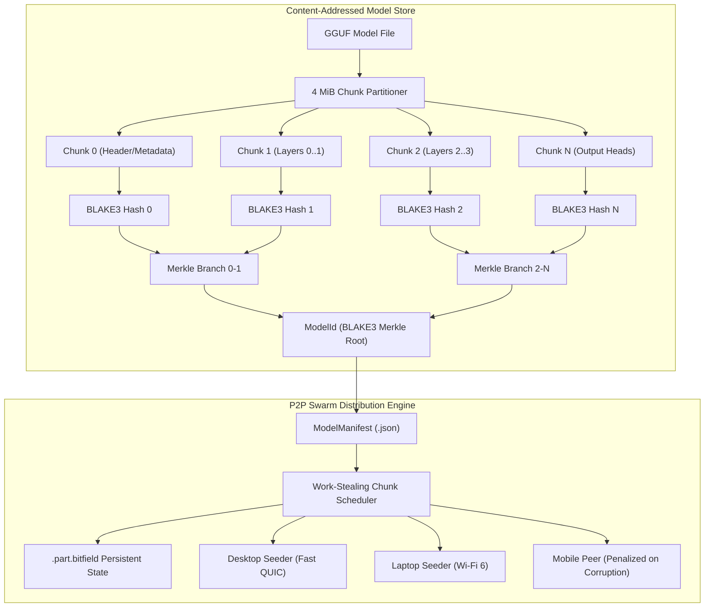

# Architecture Specification: Content-Addressed Model Registry & Resumable P2P Shard Distribution

## 1. Overview & Architectural Scope

The **UMCF Model Registry** (`crates/umcf-gguf`) provides content-addressed storage, deduplication, and resilient P2P distribution of GGUF model files across heterogeneous desktop and mobile devices.

To enable memory-constrained mobile nodes to participate in distributed inference without downloading full multi-gigabyte models, the model store decomposes models into uniform 4 MiB (`4_194_304` bytes) chunks addressed by a deterministic BLAKE3 binary Merkle tree root.



---

## 2. Content Addressing & Manifest Specification

### 2.1 Identifiers
- `ModelId`: 32-byte BLAKE3 Merkle root digest computed from the tree of 4 MiB chunk hashes. Formatted as 64 lowercase hexadecimal characters.
- `ChunkHash`: 32-byte BLAKE3 hash of an individual chunk:
  $$\text{ChunkHash}_i = \text{BLAKE3}(\text{ChunkData}_i)$$
- `Merkle Tree`: Deterministic binary pairing of chunk hashes until a single 32-byte root is reached.

### 2.2 Manifest Schema (`ModelManifest`)
```rust
pub struct ModelManifest {
    pub model_id: ModelId,
    pub filename: String,
    pub total_size_bytes: u64,
    pub chunk_size_bytes: u32,
    pub chunks: Vec<ChunkDescriptor>,
    pub tensor_shard_map: BTreeMap<String, ByteRange>,
    pub created_at_unix_ms: u64,
    pub publisher_signature: Option<Ed25519Signature>,
}
```

---

## 3. Storage Directory Structure

```text
{store_root}/
├── models/
│   ├── {model_id}.gguf                    # Verified complete model file
│   └── {model_id}_layers_{start}_{end}.shard # Partial layer shard
├── manifests/
│   └── {model_id}.json                    # Canonical manifest JSON
└── staging/
    ├── {model_id}.part.data               # In-progress pre-allocated data file
    ├── {model_id}.part.bitfield           # Persistent atomic chunk bitfield
    └── {model_id}.tmp                     # Ephemeral staging during local ingestion
```

---

## 4. Resumable P2P Swarm Synchronization

### 4.1 Persistent Bitfield (`.part.bitfield`)
Each sync session maintains a compact bit vector written atomically via temporary files:
- Byte index: $\lfloor \text{chunk\_idx} / 8 \rfloor$
- Bit mask: $1 \ll (\text{chunk\_idx} \pmod 8)$
- On restart after crash or cancellation, the downloader reloads the bitfield and skips all verified chunks with **zero redundant bytes transferred**.

### 4.2 In-Memory Chunk Verification Before Commit
Incoming chunk payloads are verified in memory before touching disk:
$$\text{BLAKE3}(\text{ReceivedPayload}) \stackrel{?}{=} \text{ChunkDescriptor.hash}$$
- If the hash matches: written to disk at offset $\text{index} \times \text{CHUNK\_SIZE}$, bit set in bitfield, and flushed.
- If the hash mismatches: payload discarded, peer penalized for 30 seconds with score reduced to 0.0, and chunk rescheduled to a healthy peer.

### 4.3 Selective Layer-Range Shard Sync (`DownloadScope`)
Nodes specify their download scope:
- `DownloadScope::FullModel`: Retrieves all chunks $0..\text{total\_chunks}$.
- `DownloadScope::LayerRange { start_layer, end_layer }`: Fetches chunk 0 (GGUF header and metadata) plus only the chunks overlapping the assigned layer block. This reduces disk and network usage by **$\ge 50\text{--}75\%$** on distributed cluster splits.

---

## 5. Peer Scoring & Work-Stealing Scheduling

Peer priority is dynamically calculated using exponential moving average (EMA) RTT and throughput:
$$\text{Score}(p) = \begin{cases} 
0.0 & \text{if } t < t_{\text{penalized}} \\
\frac{1000}{\text{RTT}_{\text{ms}} + 10} \times \frac{\text{Bandwidth}_{\text{bytes/s}}}{1{,}000{,}000} & \text{otherwise}
\end{cases}$$

---

## 6. Zero-Unsafe Memory Protection

All memory views (`VerifiedModelMmap`, `LayerRangeHandle`) adhere strictly to `#![forbid(unsafe_code)]`. Memory is backed by safe contiguous buffers (`Arc<[u8]>`) and verified against the BLAKE3 manifest before exposure to downstream inference or FFI layers.

---

## 7. GGUF Metadata Inspector & Memory Footprint Formulas (S5.P1.SP2)

### 7.1 Binary Header & Hyperparameter Parsing
The zero-copy GGUF inspector (`crates/umcf-gguf/src/parser.rs`) decodes v2/v3 models, enforcing strict upper caps:
- `MAX_METADATA_COUNT`: 10,000 keys
- `MAX_TENSOR_COUNT`: 10,000 tensors
- `MAX_STRING_LEN`: 16 MiB
- All 13 GGUF metadata types decoded without dynamic heap allocation bombs.

### 7.2 KV-Cache Calculation Equations
For both Grouped-Query Attention (GQA) and Multi-Head Attention (MHA):
$$n_{\text{embd\_gqa}} = \left( \frac{\text{embedding\_length}}{\text{head\_count}} \right) \times \text{head\_count\_kv}$$
$$\text{KV}_{\text{bytes}} = 2 \times n_{\text{layers}} \times n_{\text{ctx}} \times n_{\text{embd\_gqa}} \times \text{sizeof}(\text{KV\_dtype})$$

where:
- $\text{sizeof}(\text{F16}) = 2$ bytes
- $\text{sizeof}(\text{Q8\_0}) \approx 1.0625$ bytes ($34/32$)
- $\text{sizeof}(\text{Q4\_0}) \approx 0.5625$ bytes ($18/32$)

### 7.3 Compute & Scratch Buffer Estimation
$$\text{ComputeScratch} = \text{FFN}_{\text{scratch}} + \text{Attention}_{\text{scratch}} + \text{BaseOverhead}$$
- $\text{FFN}_{\text{scratch}} = 4 \times \text{feed\_forward\_length} \times n_{\text{ubatch}} \times 4$
- $\text{Attention}_{\text{scratch}} = \text{head\_count} \times \text{head\_dim} \times n_{\text{ubatch}} \times 4$ (with Flash Attention)
- $\text{BaseOverhead} = 48 \text{ MiB}$

### 7.4 Device Compatibility & Safety Headroom Rules
$$\text{SafeAvailableRAM} = \begin{cases}
\text{RAM}_{\text{available}} - 1.5 \text{ GiB} & \text{on Android / iOS (LMK protection)} \\
\text{RAM}_{\text{available}} - (0.15 \times \text{RAM}_{\text{total}}) & \text{on Desktop macOS/Windows/Linux}
\end{cases}$$

If $\text{TotalRequired} > \text{SafeAvailableMemory}$, the validator returns `RequiresClusterSplit` with recommended pipeline layer partitions.


