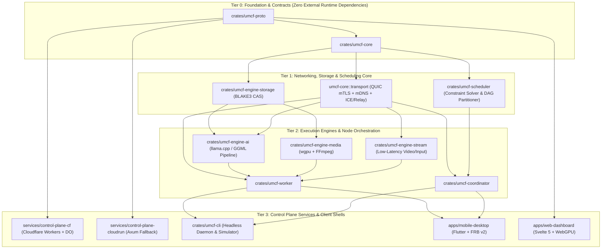

# Universal Mobile Compute Fabric (UMCF) — Risk Register, Technical Uncertainties & Prototype Validation Strategy

> [!IMPORTANT]
> Before committing to full-scale multi-platform implementation, all high-uncertainty architectural assumptions are isolated into **6 bounded prototype spikes (`P-01` through `P-06`)** and tracked in a formal **Risk Register** with quantitative thresholds, mitigations, and deterministic fallbacks.

---

## 1. Crate & Service Implementation Dependency DAG

---

## 2. Pre-Implementation Technical Uncertainties & Prototype Spikes

Every architectural uncertainty is paired with a minimal, self-contained prototype validation spike that runs inside the **30 GB Podman simulation environment** before production integration.

| Spike ID | Technical Uncertainty | Prototype Validation Method | Pass/Fail Quantitative Threshold | Fallback Strategy if Threshold Missed |
| :--- | :--- | :--- | :--- | :--- |
| **`P-01`** | **Inter-Node QUIC Activation Overhead for `llama.cpp` Pipeline Parallelism**: Will per-token network serialization + RTT across 2–4 nodes dominate decode latency? | Spawn 3 containerized `umcf-worker` nodes connected via `tc netem` simulated Wi-Fi (`2ms` RTT, `200 Mbps`) running a 3-stage pipeline of a quantized transformer. Compare `FP16` vs `Q8_0` activation framing over persistent QUIC streams with `TCP_NODELAY`/zero-copy buffers. | Inter-stage serialization + transport overhead MUST be `< 2.5ms` per hop on LAN (`< 10%` of total token generation time for 8B+ models). | Enable `Q8_0` activation compression by default; reduce pipeline hop count `k` in `umcf-scheduler` cost function; use speculative decoding (draft model on Master) to amortize network RTT over 4–8 tokens per round-trip. |
| **`P-02`** | **Symmetric NAT Traversal Success Rate & Relay Failover Latency**: How reliably does simultaneous UDP hole-punching over `quinn` succeed across carrier-grade NAT (CGNAT) and enterprise firewalls? | Test `umcf-core::transport` in a multi-namespace Podman network topology simulating Full-Cone, Address-Restricted, Port-Restricted, and Symmetric NATs using `nftables`. Measure time-to-first-byte across direct and TURN/DERP relay paths. | Direct P2P connection established in `<= 600ms` for Cone NATs; automatic fallback to QUIC-in-QUIC relay completed in `<= 900ms` total for Symmetric/Blocked NATs with zero dropped application requests. | Parallelize "Happy Eyeballs" style connection establishment: initiate standby relay tunnel handshake at `t = 250ms` while UDP hole-punching continues in background; seamlessly migrate to direct P2P if hole-punch succeeds later. |
| **`P-03`** | **Mobile OS Background Execution & Thermal Preemption Latency**: Can Android/iOS workers detect thermal throttling or OS background eviction fast enough to migrate or checkpoint KV-cache state? | Simulate sudden thermal ramp (`ThermalState::Serious -> Critical`) and `onTrimMemory` / lifecycle suspension signals in `umcf-worker`. Measure time to notify coordinator and either stream KV-cache or trigger upstream prompt re-prefill. | Coordinator notified within `< 150ms`; pipeline rebalanced to standby node or reduced-layer configuration in `< 1,500ms` without dropping the client inference session. | Maintain token ID history (`Vec<u32>`, `< 32 KB` for 8k context) at the pipeline head (Master) at all times so any failed intermediate worker can be replaced via fast batched prompt re-prefill without relying on the dying worker to upload its multi-megabyte KV-cache. |
| **`P-04`** | **Cross-Platform GPU Compute Shader Portability (`wgpu` / WGSL)**: Do numerical outputs of quantized matrix/media compute kernels match across Vulkan, Metal, DX12, and WebGPU? | Execute identical WGSL compute kernels across Mesa Lavapipe/Vulkan (in Podman) and native host GPU backends, comparing output tensors against CPU FP32 reference. | Cosine similarity `>= 0.9995` and max absolute error `<= 1e-3` for FP16/Q8 compute kernels across all backends. | Restrict cross-vendor GPU collaboration within a single job to coarse-grained task boundaries (e.g., separate video GOPs or transformer layer boundaries with RMSNorm stabilization). |
| **`P-05`** | **Podman Container Disk Footprint Ceiling (`<= 30 GB`)**: Full Rust cross-compilation toolchains (Android NDK, Linux, Windows, WASM, `llama.cpp`, FFmpeg) easily exceed 50+ GB if unoptimized. | Construct a layered rootless Podman build using Debian Bookworm Slim, `cargo-zigbuild` / `cargo-ndk`, sccache, and shared host volume mounts with automated quota monitoring. | Peak container images + build cache + test artifacts MUST remain `< 25.0 GB` (providing a 5 GB safety margin below the hard 30 GB limit). | Use dynamic linking for system libraries in test binaries, strip debug symbols (`strip = "debuginfo"` in dev/test profiles), and run `cargo sweep` / `podman system prune` hooks automatically between stage builds. |
| **`P-06`** | **Glass-to-Glass Latency in Remote Streaming Engine (`umcf-engine-stream`)**: Can QUIC Datagrams + WebRTC deliver sub-frame-budget latency without visual corruption under 1–2% Wi-Fi packet loss? | Stream a synthetic 120Hz timestamped test pattern over a simulated 1% lossy link using slice-based intra-refresh and Reed-Solomon FEC (`k=8, m=2`). | Median end-to-end LAN latency `< 16.6ms` (1080p60/120); zero full-frame freezes under `<= 2%` random packet loss. | Fall back from unreliable QUIC Datagrams to short-TTL partial-reliability streams or dynamically request Instantaneous Decoder Refresh (IDR) slices for corrupted macroblock rows. |

---

## 3. Comprehensive Risk Register

| Risk ID | Category | Risk Description | Prob. (1-5) | Impact (1-5) | Severity ($P \times I$) | Proactive Mitigation Strategy | Trigger / Contingency Fallback |
| :--- | :--- | :--- | :---: | :---: | :---: | :--- | :--- |
| **`R-01`** | **Performance / Network** | **High Wi-Fi Jitter Stalls Pipeline Parallelism**: Consumer Wi-Fi spike (`50ms+` bufferbloat) stalls autoregressive token generation across multi-node pipelines. | 4 | 4 | **16 (High)** | Use `Q8_0` compressed activations; enable QUIC BBRv2 congestion control; implement speculative decoding at the Master node so 1 round-trip verifies multiple tokens. | If rolling P95 inter-node RTT exceeds `25ms`, `umcf-scheduler` consolidates layers onto fewer nodes or switches the slow peer to asynchronous batch/prefill-only roles. |
| **`R-02`** | **Mobile OS Constraints** | **iOS / Android Aggressive Background Process Kill**: Mobile OS terminates `umcf-worker` mid-inference without warning when the user switches apps. | 5 | 3 | **15 (High)** | On Android, run a user-visible `ForegroundService` (`specialUse` / `connectedDevice`) with WakeLock/WifiLock. On iOS, restrict worker participation to foreground active mode or plugged-in guided session. | Master always retains the compact token ID sequence (`< 32 KB`) and replays batched prefill onto a surviving worker within `< 1.5s` upon QUIC stream reset. |
| **`R-03`** | **Hardware Safety** | **Battery Drain & Thermal Runaway on Smartphones**: Sustained LLM or GPU workloads overheat mobile batteries (`> 43°C`), degrading hardware health or UX. | 4 | 4 | **16 (High)** | Enforce hard hardware telemetry polling every `1,000ms` in `umcf-worker`. Default mobile policy requires AC power or battery `>= 30%`, and caps sustained duty cycle at `41°C` (Serious) and cuts off at `43°C` (Critical). | Immediate task preemption at `43°C` with mandatory cool-down hysteresis (`<= 39°C`) before re-admitting any compute leases. |
| **`R-04`** | **Memory Stability** | **Mobile OOM Killer (`lmkd` / Jetsam) Crash**: Allocating large GGUF model slices triggers OS Out-Of-Memory termination of the entire Flutter app. | 3 | 5 | **15 (High)** | Enforce strict `allocatable_ram_bytes <= 0.75 * available_ram_bytes` invariant in `umcf-core`. Pre-check `mmap` resident set limits before accepting any `TaskLeaseAssign`. | Hook Android `onTrimMemory(TRIM_MEMORY_RUNNING_CRITICAL)` and iOS `didReceiveMemoryWarning` to immediately unmap non-essential CAS buffers and request lease handoff. |
| **`R-05`** | **Control Plane Availability** | **Cloudflare Edge / Free-Tier Quota Exhaustion or Regional Block**: Primary WAN signaling plane becomes unreachable or rate-limited. | 2 | 4 | **8 (Med)** | Throttle non-critical WAN telemetry updates (delta-only capability updates); batch ICE candidates; keep LAN traffic 100% local via mDNS. | Automatic client failover to `services/control-plane-cloudrun` after `3,000ms` timeout, or seamless downgrade to `Local Autonomous Coordinator` on LAN. |
| **`R-06`** | **Security** | **Malicious or Compromised Peer Injects Crafty Tensor / Shader Payload**: A rogue node in a shared cluster sends malformed GGUF metadata, NaN tensors, or unbounded WGSL loops. | 2 | 5 | **10 (Med)** | Mutual Ed25519 mTLS authentication; BLAKE3 hash verification on all CAS chunks; strict bounds checking on `TensorRpcForward` dimensions; `naga` shader validation with GPU watchdog timeouts. | Automatically quarantine and revoke the `NodeId` lease of any peer returning invalid signatures, mismatched BLAKE3 chunks, or NaN/Inf tensor activations. |
| **`R-07`** | **Dev Environment** | **Podman Storage Exceeds 30 GB Cap During Multi-Target Compilation**: Rust `target/` debug artifacts and container layers fill the allocated 30 GB disk budget. | 4 | 3 | **12 (Med)** | Configure `.cargo/config.toml` with `debug = 0` or `line-tables-only` for dev/test builds, share a single cargo cache volume, and enforce a pre-build disk check script (`scripts/check-disk-budget.sh`). | Fail fast at `27 GB` usage and automatically execute incremental artifact cleanup (`cargo clean -p` on completed stages and `podman image prune`). |
| **`R-08`** | **Distributed State** | **Split-Brain Coordinator During LAN/WAN Partition**: Two Hybrid nodes both claim Master role when Wi-Fi briefly disconnects from WAN. | 2 | 4 | **8 (Med)** | Monotonic `lease_epoch` fencing tokens attached to all `WireEnvelope` control commands; deterministic tie-breaking via `ElectionScore` and `NodeId`. | Workers reject commands from lower `lease_epoch` masters; upon partition heal, the lower-epoch coordinator steps down and reconciles job state from worker lease reports. |
