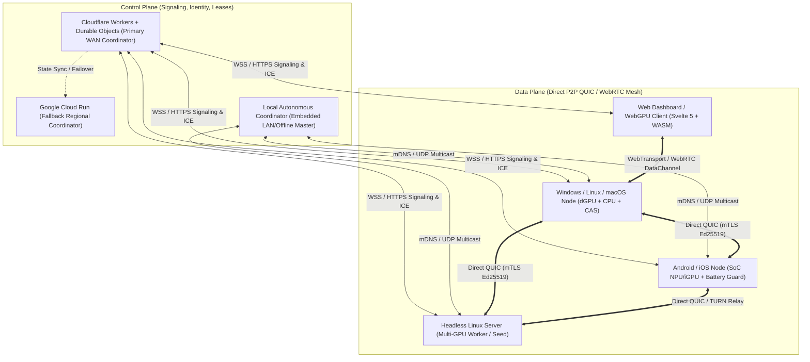
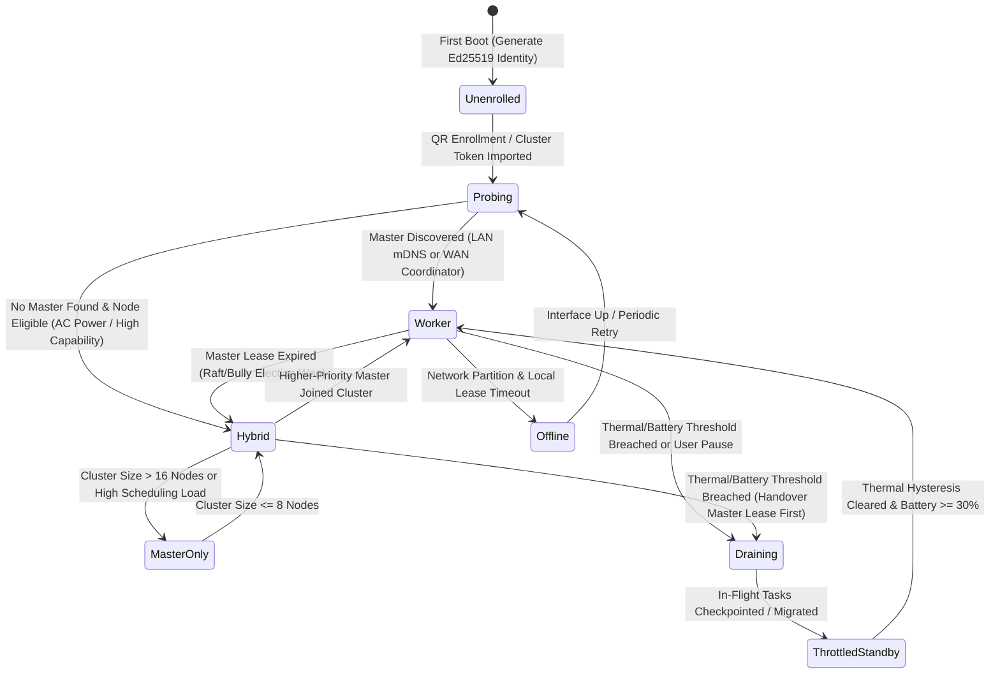
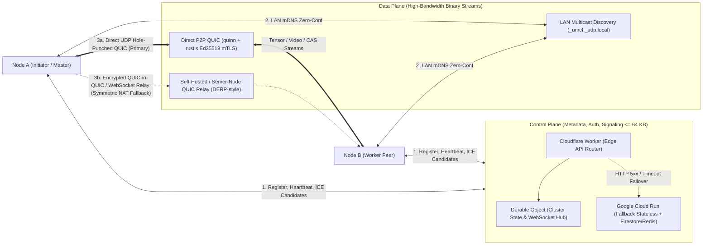
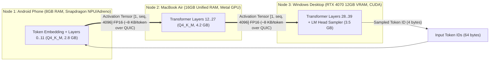

# Universal Mobile Compute Fabric (UMCF) — System Architecture Overview

> [!IMPORTANT]
> **Architectural Invariant**: UMCF strictly separates the **Control Plane** (cluster coordination, node identity, signaling, and lease governance) from the **Data Plane** (high-throughput, low-latency P2P QUIC streams for tensors, media frames, input events, and content-addressed blobs). Furthermore, UMCF explicitly rejects transparent shared-memory hardware pooling across heterogeneous ISA/memory boundaries in favor of **capability-negotiated pipeline, tensor, and task partitioning**.

---

## 1. Executive Summary & Architectural Vision

The **Universal Mobile Compute Fabric (UMCF)** is a cross-platform distributed compute runtime, peer-to-peer mesh network, and workload orchestrator spanning **Android, iOS, Windows, Linux, macOS, Web browsers, and headless Server nodes**. UMCF enables arbitrary user-owned devices to form an authenticated, self-healing compute fabric capable of:

1. **Distributed AI Inference**: Running large language models (LLMs) and multimodal models across heterogeneous devices using layer-partitioned pipeline parallelism and RPC tensor forwarding (built atop `llama.cpp` and GGML backends).
2. **Distributed GPU & Media Compute**: Partitioning video transcoding, rendering, and compute shader workloads across Vulkan, Metal, DirectX 12, WebGPU, and FFmpeg pipelines.
3. **Low-Latency Remote Desktop & Game Streaming**: Streaming hardware-encoded desktop/application viewports over QUIC/WebRTC with sub-16ms local decode and high-frequency input return channels.
4. **Content-Addressed Distributed Storage (CAS)**: Deduplicated, BLAKE3-verified chunk distribution for model weights, shader caches, and job artifacts across LAN and WAN peers.

---

## 2. Multi-Platform Node Topology

UMCF treats every participating device as a **Fabric Node** executing the unified Rust core (`umcf-core`, `umcf-proto`, `umcf-worker`, `umcf-coordinator`, `umcf-scheduler`) either natively via C-FFI/Flutter Rust Bridge or compiled to WebAssembly (`wasm32-unknown-unknown`) in browser environments.

### Platform Capability Matrix

| Platform | Target Triple(s) | UI Shell | Compute Backends | Network Transport | Background Execution Constraints |
| :--- | :--- | :--- | :--- | :--- | :--- |
| **Android** | `aarch64-linux-android`, `x86_64-linux-android` | Flutter 3.x + `flutter_rust_bridge` | Vulkan, OpenCL, QNN/NNAPI (via GGML), CPU NEON | QUIC (`quinn`), UDP mDNS, WebRTC | Foreground Service notification required; Doze mode & thermal throttling hooks |
| **iOS / iPadOS** | `aarch64-apple-ios` | Flutter 3.x + `flutter_rust_bridge` | Metal, Accelerate/AMX, CoreML | QUIC (`quinn`), Bonjour mDNS, WebRTC | Strict background suspension; active only in foreground or plugged-in audio/compute session |
| **Windows** | `x86_64-pc-windows-msvc`, `aarch64-pc-windows-msvc` | Flutter Desktop / CLI Daemon | CUDA, DirectX 12, Vulkan, AVX2/AVX-512 | QUIC (`quinn`), UDP mDNS, Named Pipes | Unrestricted service or tray daemon; power plan awareness |
| **Linux** | `x86_64-unknown-linux-gnu`, `aarch64-unknown-linux-gnu` | Flutter Desktop / Systemd Daemon | CUDA, ROCm, Vulkan, SYCL, AVX-512/NEON | QUIC (`quinn`), Avahi/UDP mDNS, Unix Sockets | Unrestricted daemon (`systemd`); cgroups v2 memory/CPU isolation |
| **macOS** | `aarch64-apple-darwin`, `x86_64-apple-darwin` | Flutter Desktop / LaunchAgent | Metal (Unified Memory), Accelerate | QUIC (`quinn`), Bonjour mDNS | App Nap prevention assertion (`IOPMAssertionCreateWithName`) |
| **Web** | `wasm32-unknown-unknown` | Svelte 5 + TypeScript | WebGPU, WASM SIMD128 | WebTransport, WebRTC DataChannel, WSS | Browser tab lifecycle, 4GB WASM32 memory ceiling per worker |
| **Server** | `x86_64-unknown-linux-musl` (Containerized) | CLI / Headless | Multi-GPU CUDA/ROCm/Vulkan | Public IP QUIC + Embedded TURN/DERP Relay | Dedicated compute & CAS caching |

---

## 3. Dynamic Role State Machine (Master / Worker / Hybrid)

Every native UMCF node embeds `umcf-coordinator`, `umcf-scheduler`, and `umcf-worker`. A node is not statically compiled as a client or server; instead, it transitions dynamically across roles based on cluster health, user policy, power state, and hardware capabilities.

### Role Definitions
- **`Idle / Unenrolled`**: Node has generated its local Ed25519 identity keypair (`NodeId`) but has not joined a fabric cluster or been granted an RBAC capability token.
- **`Worker`**: Executes assigned DAG subtasks (inference layers, media segments, storage serving) and reports telemetry heartbeats every 1,000ms.
- **`Master (Coordinator)`**: Maintains the authoritative cluster registry, evaluates the DAG constraint solver (`umcf-scheduler`), issues lease tokens, and monitors heartbeats. Runs minimal local compute to preserve scheduling responsiveness.
- **`Hybrid (Master + Worker)`**: Default role for high-capability desktop/server nodes in small clusters (`<= 16` nodes), running both the Local Autonomous Coordinator (`umcf-coordinator`) and local compute execution engines (`umcf-worker`).
- **`Draining / Throttled`**: Node has hit a thermal threshold (`>= 43°C` battery or `>= 85°C` die temp), low battery (`< 20%` unplugged), or user pause request. Rejects new task admissions while migrating or checkpointing in-flight stages.

### Coordinator Election & Split-Brain Prevention
1. **WAN Connected Mode**: The Cloudflare Durable Object (`ClusterCoordinatorDO`) acts as the monotonic lease authority for the cluster's control plane, issuing epoch-numbered leadership leases (`lease_epoch: u64`, TTL `15s`) to the best local node for low-latency LAN scheduling, or coordinating directly if peers span disjoint WAN NATs.
2. **LAN Autonomous Mode (Offline-First)**: When WAN is unreachable, nodes on the same broadcast domain discover each other via UDP mDNS (`_umcf._udp.local`) and elect a `Local Autonomous Coordinator` using a deterministic score function:
   $$\text{ElectionScore}(n) = 1000 \cdot \mathbb{I}(\text{AC\_Power}_n) + 500 \cdot \mathbb{I}(\text{Wired\_NIC}_n) + 10 \cdot \text{RAM\_GB}_n + \text{Uptime\_Hours}_n$$
   Ties are broken deterministically by lexicographical comparison of `NodeId` (Blake3 hash of the node's Ed25519 public key). Fencing tokens (`lease_epoch`) are attached to every control message; workers immediately reject RPC commands bearing a stale `lease_epoch`.

---

## 4. Strict Separation of Control Plane and Data Plane

> [!WARNING]
> **Zero-Payload Control Plane Rule**: Model weights, KV-cache tensors, raw audio/video frames, and CAS file chunks **never** traverse the Control Plane (Cloudflare Workers or Cloud Run). The Control Plane handles exclusively JSON/Protobuf metadata envelopes (`<= 64 KB`).

### 4.1 Control Plane Tiering
1. **Primary WAN Control Plane (`services/control-plane-cf`)**:
   - **Cloudflare Workers**: Globally distributed edge entry point verifying Ed25519 request signatures and RBAC JWTs at the edge before routing to the cluster's Durable Object.
   - **Cloudflare Durable Objects**: Strongly consistent, single-threaded actor per `ClusterId`. Maintains active WebSocket signaling connections, stores node capability summaries, coordinates STUN/ICE candidate exchange, and persists audit logs in Durable Object SQLite storage.
2. **Fallback WAN Control Plane (`services/control-plane-cloudrun`)**:
   - Containerized Rust (`axum`) service deployed on Google Cloud Run.
   - Activated automatically by `umcf-core` client health probes if the primary Cloudflare endpoint returns `5xx` or fails TLS/DNS resolution for `> 3,000ms`.
3. **Local Autonomous Coordinator (`crates/umcf-coordinator`)**:
   - Embedded directly in every native node binary. Operates with zero external internet dependency when devices share a Wi-Fi, Ethernet, or mobile hotspot subnet.

### 4.2 Data Plane Multiplexing over QUIC
Once two peers establish a connection (via LAN direct IP, STUN hole-punching, or TURN/DERP relay), they authenticate via **RFC 7250 Raw Public Keys** (or self-signed X.509 certificates wrapping their Ed25519 `NodeId` keypair) over **QUIC (`quinn`)**. All Data Plane traffic is multiplexed over a single UDP socket per peer pair to avoid head-of-line blocking:

| Stream / Datagram Type | QUIC Primitive | Priority | Reliability | Primary Consumers |
| :--- | :--- | :--- | :--- | :--- |
| **Control & RPC Framing** | Bidirectional Stream | Highest (`0`) | Reliable Ordered | `umcf-coordinator`, `umcf-worker` lifecycle |
| **Input Events (Mouse/KB/Gamepad)** | Unidirectional Stream / Datagram | Critical (`1`) | Reliable (clicks/keys) + Unreliable Datagram (motion) | Remote Desktop & Game Streaming Engine |
| **LLM Activation Tensors (`llama.cpp` RPC)** | Bidirectional Stream | High (`2`) | Reliable Ordered (Zero-copy framed) | Distributed AI Engine (`umcf-engine-ai`) |
| **Realtime Video / Audio Frames** | QUIC Datagrams / WebRTC RTP | High (`2`) | Unreliable / Partial-Reliability (FEC) | Remote Streaming Engine (`umcf-engine-stream`) |
| **Media Transcode Segments** | Bidirectional Stream | Normal (`3`) | Reliable Ordered | GPU/Media Engine (`umcf-engine-media`) |
| **CAS Model Weights & Blobs** | Unidirectional Stream | Background (`4`) | Reliable Ordered (LEDBAT/BBRv2 paced) | Distributed Storage Engine (`umcf-engine-storage`) |

---

## 5. Heterogeneous Hardware Model (Why Transparent Pooling Fails)

> [!CAUTION]
> **Physical Reality of Heterogeneous Compute**: A common misconception in distributed consumer compute is that 4 smartphones with 8 GB RAM each and 1 desktop with a 12 GB discrete GPU can be combined into a "single virtual 44 GB GPU" via transparent shared memory. **This is physically impossible at acceptable performance** due to memory coherence latency, interconnect bandwidth asymmetry, and ISA divergence.

### 5.1 Architectural Bottlenecks of Naive Memory Pooling
1. **Interconnect Bandwidth vs. Memory Bus Asymmetry ($1,000\times$ to $10,000\times$ Gap)**:
   - Apple M-series Unified Memory or NVIDIA RTX VRAM operates at **$400\text{ GB/s}$ to $1,000\text{ GB/s}$** with sub-100ns latency.
   - Wi-Fi 6 / Gigabit Ethernet operates at **$0.05\text{ GB/s}$ to $0.12\text{ GB/s}$** with $1\text{ ms}$ to $5\text{ ms}$ round-trip latency.
   - Intercepting page faults (`userfaultfd` / DSM) or fine-grained GPU kernel memory reads across a network link stalls compute units for millions of clock cycles per memory access.
2. **ISA & Execution Model Divergence**:
   - **CPUs** (`x86_64` AVX-512, `aarch64` NEON/SVE) excel at branching logic, tokenization, and small-batch quantized matrix-vector multiplication.
   - **Discrete GPUs** (CUDA, ROCm, Vulkan/DX12) require massive SIMT parallelism and explicit host-to-device PCIe transfers.
   - **Integrated GPUs / Unified SoCs** (Apple Metal, Snapdragon Adreno) share physical DRAM with the CPU (zero-copy buffer mapping) but are strictly thermally constrained.
   - **Mobile NPUs** (Qualcomm Hexagon QNN, Apple Neural Engine, MediaTek APU) only support fixed-graph static tensor shapes and specific quantization formats (`INT4`/`INT8`/`FP16`), lacking general-purpose dynamic control flow.

### 5.2 UMCF's Solution: Capability-Negotiated Partitioning

Instead of transparent shared memory, UMCF models the cluster as a **Directed Acyclic Graph (DAG) of Heterogeneous Compute Stages** where data transfers occur **only at explicit, low-bandwidth stage boundaries**:

#### Partitioning Strategies by Workload Domain

| Workload Domain | Partitioning Strategy | Local State Kept on Worker | Network Traffic per Step |
| :--- | :--- | :--- | :--- |
| **LLM Inference (`umcf-engine-ai`)** | **Layer-Wise Pipeline Parallelism**: Contiguous blocks of transformer layers ($L_i \dots L_j$) are pinned to each node proportional to available VRAM/RAM and compute FLOPS. | Model weights for layers $L_i \dots L_j$ + local slice of the KV-Cache. | Only intermediate hidden state activations ($\text{batch} \times \text{seq\_len} \times d_{\text{model}} \times 2\text{ bytes}$, typically $8\text{ KB}$ per token during decoding). |
| **Batch Image / Diffusion / Embeddings** | **Data / Micro-Batch Parallelism**: Model replicated across capable nodes; input prompts/images sharded by batch index. | Full quantized model weights in local VRAM/NPU memory. | Input prompt/image payload + output embedding vector or generated image. |
| **Video Transcoding & Rendering (`umcf-engine-media`)** | **GOP / Tile Task Parallelism**: Video split at keyframe Group-of-Pictures (GOP) boundaries or 3D frames split by tile/frame range. | Hardware codec context (NVENC, VideoToolbox, MediaCodec) + CAS input chunk. | Compressed bitstream chunks via Content-Addressed Storage. |
| **Remote Game / App Streaming (`umcf-engine-stream`)** | **Asymmetric Producer-Consumer Pipeline**: Host dGPU captures & encodes (`NVENC`/`AMF`); thin mobile/web client decodes via hardware `MediaCodec`/`WebCodecs`. | Framebuffer on Host; jitter buffer & decode surface on Client. | H.264/HEVC/AV1 RTP/QUIC datagrams ($5\text{--}50\text{ Mbps}$) + 120Hz input events ($< 50\text{ Kbps}$). |

---

## 6. Security, Trust & Sandboxing Architecture

1. **Zero-Trust Cryptographic Identity**:
   - Every node generates an **Ed25519** identity keypair on first boot, stored in the OS hardware-backed keystore (Android Keystore, iOS Keychain/Secure Enclave, Windows DPAPI, macOS Keychain, Linux Secret Service / `0600` encrypted keyfile).
   - `NodeId` is the canonical `umcf1_<base32(blake3(pubkey)[0..20])>` identifier.
2. **Mutual Attestation & Enrollment**:
   - Joining a cluster requires scanning a time-bound QR code or importing a single-use enrollment token signed by the cluster owner's Root Key.
   - All P2P QUIC connections enforce mutual TLS (`mTLS`) pinned to the cluster's authorized `NodeId` registry.
3. **Execution Sandboxing & Resource Guards**:
   - Workers never execute arbitrary unverified native binaries from peers. Only built-in, statically linked engines (`llama.cpp` GGML graph interpreter, FFmpeg media pipeline, WebGPU/WGSL compute shaders, and Wasmtime sandboxed modules) are invoked.
   - `umcf-worker` enforces strict memory watermarks (never exceeding 75% of free system RAM on mobile or configured VRAM budget on desktop) and thermal/battery cutoff circuit breakers.
4. **Reproducible 30 GB Containerized Build & Test Footprint**:
   - All development, cross-compilation, and multi-node simulation run inside rootless **Podman** containers subject to a hard **30 GB total disk footprint budget** (enforced via multi-stage builds, shared `/target` cache mounts, and stripped release artifacts).
