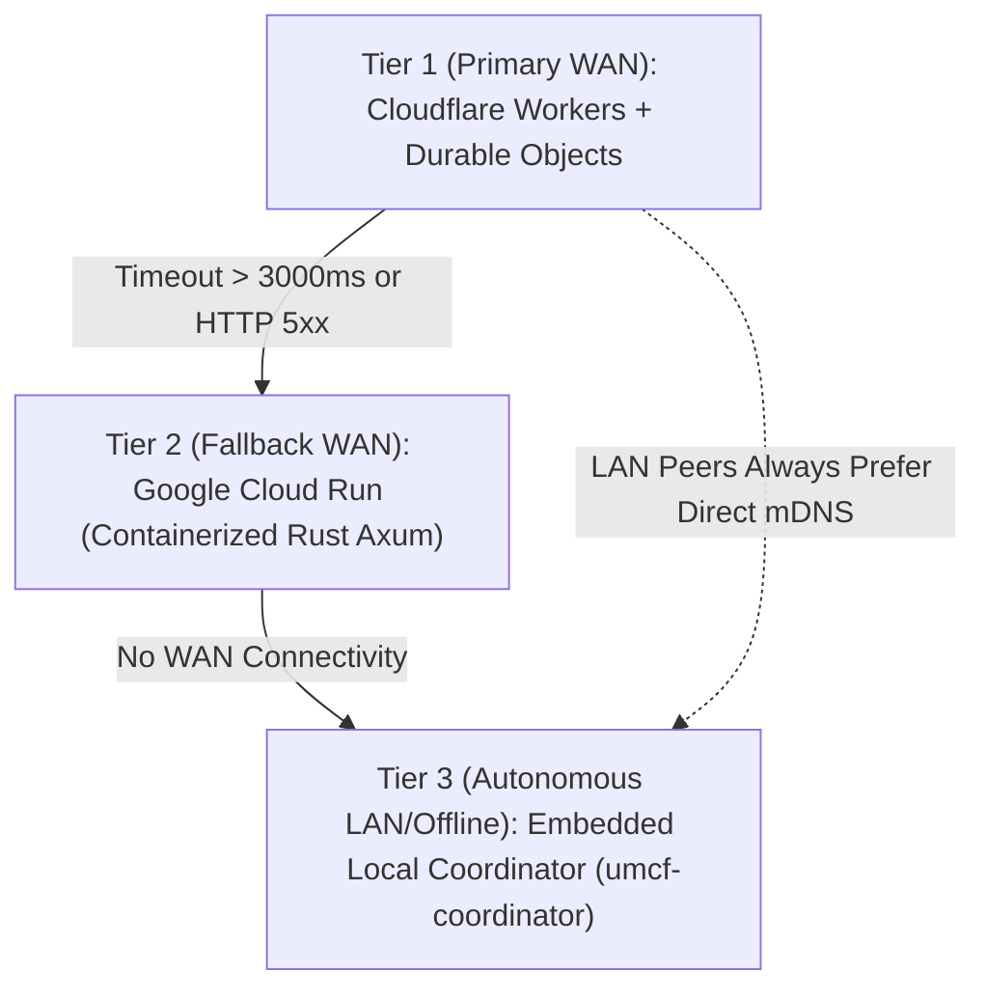

# ADR-0002: Strict Separation of Control Plane and Data Plane with Three-Tier Coordinator Failover

- **Status**: Accepted
- **Date**: 2026-11-10
- **Deciders**: UMCF Core Architecture Team
- **Related Components**: `services/control-plane-cf`, `services/control-plane-cloudrun`, `crates/umcf-coordinator`, `crates/umcf-core`

---

## 1. Context and Problem Statement

UMCF nodes operate across diverse network environments: home Wi-Fi LANs, cellular 5G networks behind Symmetric Carrier-Grade NAT (CGNAT), enterprise firewalls, and completely offline field deployments. Meanwhile, UMCF workloads transfer gigabytes of model weights and continuous real-time tensor/video streams.

Routing bulk data through centralized cloud servers would incur astronomical egress bandwidth costs, introduce unnecessary WAN latency (`50ms+`) for co-located devices in the same room, and create a single point of failure when internet access drops.

## 2. Decision Drivers

1. **Zero Cloud Egress for Bulk Compute Data**: Cloud infrastructure must remain viable on free/low-cost serverless tiers.
2. **Sub-2ms LAN Latency**: Two devices on the same Wi-Fi/Ethernet subnet must communicate directly at wire speed without hairpinning through a WAN server.
3. **Offline-First Resilience**: A user on an airplane or isolated LAN must retain full ability to form a cluster and run distributed inference across their laptop, tablet, and phone.
4. **High Availability Across WAN**: When devices span separate geographic locations, signaling and cluster coordination must survive regional cloud outages or ISP blocks.

## 3. Decision Outcome

We enforce a **strict architectural boundary** between the **Control Plane** and the **Data Plane**, backed by a **three-tier Control Plane failover hierarchy**:

### 3.1 Control Plane Rules
- Handles **exclusively** cluster enrollment, Ed25519 attestation, RBAC token issuance, heartbeat liveness, job DAG metadata, and ICE/STUN signaling.
- Enforces a hard **64 KiB maximum frame size** (`MAX_CONTROL_FRAME_BYTES = 65_536`).
- **Primary WAN (`services/control-plane-cf`)**: Uses Cloudflare Workers for edge signature verification and **Durable Objects** (`ClusterCoordinatorDO`) for strongly consistent per-cluster state and WebSocket signaling.
- **Fallback WAN (`services/control-plane-cloudrun`)**: Stateless Rust `axum` service deployed on Google Cloud Run, automatically selected by `umcf-core` if the primary endpoint fails health probes.
- **Local Autonomous Coordinator (`crates/umcf-coordinator`)**: Embedded in every native node binary; elected automatically via deterministic `ElectionScore` over UDP mDNS (`_umcf._udp.local`) when operating on a local network or offline.

### 3.2 Data Plane Rules
- Carries **100% of tensor activations, KV-cache syncs, CAS model chunks, video/audio frames, and input events**.
- Operates exclusively over **end-to-end encrypted P2P QUIC (`quinn`)** or **WebRTC**, authenticated via mutual Ed25519 public keys pinned during Control Plane enrollment.

## 4. Consequences

### Positive
- **Near-Zero Cloud Cost**: Even a 100-node cluster streaming 4K video and transferring 70B LLM weights generates only kilobytes per minute of Control Plane signaling traffic.
- **100% Offline Capability**: Zero degradation on local networks when internet connectivity is severed.
- **Zero-Trust Privacy**: Cloud providers (Cloudflare / Google Cloud) never see user prompts, model activations, desktop video streams, or files.

### Negative & Mitigations
- **Split-Brain Risk During WAN/LAN Transitions**: A LAN cluster reconnecting to WAN must reconcile state with the WAN Durable Object. *Mitigation*: Enforce monotonic `lease_epoch: u64` fencing tokens across all Control Plane tiers (see `COMPONENT_CONTRACTS.md` Section 4.2).
