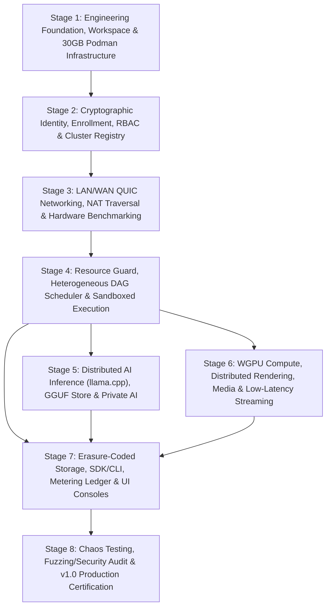

# Universal Distributed Mobile-First Compute Fabric (UMCF) — Master Implementation Roadmap

> **Document ID:** `UMCF-IMPL-ROADMAP-v1.0`  
> **Architecture Standard:** Section 3 — Multi-Stage Hierarchical Implementation Specification  
> **Target Environment:** Podman Rootless Containerized Toolchain (`<= 30 GB` Hard Storage Ceiling)  
> **Core Stack:** Rust (Workspace Core, QUIC/mTLS, Scheduler, `llama.cpp` FFI, WGPU, Storage), Flutter (Android, iOS, Windows, macOS, Linux), Svelte 5 + TypeScript (Web Dashboard & PWA), Cloudflare Workers + Durable Objects (Primary Edge Control Plane), Google Cloud Run (Fallback Control Plane)

---

## 1. Executive Summary & Architectural Hierarchy

The Universal Distributed Mobile-First Compute Fabric (**UMCF**) transforms heterogeneous consumer and enterprise devices—smartphones, tablets, laptops, desktops, workstations, and edge servers—into a unified, consent-driven, cryptographically verified peer-to-peer compute, AI inference, media processing, rendering, and distributed storage mesh.

### 1.1 Strict Execution Hierarchy
Every engineering activity in UMCF adheres to the 8-tier verification hierarchy:

```text
Stage (S1..S8)
 └── Phase (P1..P3)
      └── Subphase (SP1..SP3)
           └── Implementation Tasks (Concrete files, structs, traits, APIs, CLI flags)
                └── Acceptance Criteria (Measurable latency, memory, throughput, security invariants)
                     └── Tests (Unit, Integration, Simulation, Hardware-Required, Manually Verified)
                          └── Evidence (Deterministic JSON/log artifacts, checksums, coverage reports)
                               └── Documentation (Architecture docs, API specs, TODO.md, CHANGELOG.md)
```

- **8 Stages (`S1` – `S8`)**: Macro-milestones taking the platform from repository bootstrap and 30 GB Podman toolchain enforcement through v1.0 production certification.
- **24 Phases (`3 per Stage`)**: Cohesive subsystem deliveries with explicit phase-level integration gates and rollback boundaries.
- **72 Subphases (`3 per Phase`, `9 per Stage`)**: Atomic, single-PR executable engineering units with zero-placeholder implementation mandates.

---

## 2. Monorepo Crate & Directory Topology

All stages converge on the following canonical workspace layout:

```text
ucf/
├── Cargo.toml                          # Rust workspace root (resolver = "2")
├── Podmanfile / compose.podman.yml     # Reproducible rootless Podman build/test containers (<= 30 GB ceiling)
├── crates/
│   ├── umcf-proto/                     # S1.P2.SP1: Versioned wire envelopes, Protobuf/bincode codecs, negotiation
│   ├── umcf-core/                      # S1.P2.SP2: Hardware descriptors, DIDs, resource units, domain primitives
│   ├── umcf-telemetry/                 # S1.P2.SP3: OpenTelemetry tracing, structured metrics, RFC-9457 error taxonomy
│   ├── umcf-identity/                  # S2.P1: Ed25519/X25519 keys, DID:key/DID:peer, OS Keychain/Vault, X.509/CWT certs
│   ├── umcf-enrollment/                # S2.P2: Short-lived QR tokens, RBAC policy engine, Master/Worker/Hybrid election
│   ├── umcf-registry/                  # S2.P3: Redb/SQLite local state store, CRDT/Raft sync, cloud control-plane client
│   ├── umcf-net/                       # S3.P1-P2: mDNS/UDP discovery, Quinn QUIC mTLS, QoS, STUN/ICE, DERP/TURN relay
│   ├── umcf-hwprobe/                   # S3.P3: CPU/RAM/thermal/battery probes, Vulkan/Metal/DX12/NPU enum, benchmarks
│   ├── umcf-guard/                     # S4.P1: cgroups v2 / Windows Job Objects, battery/thermal guards, user preemption
│   ├── umcf-scheduler/                 # S4.P2: Capability constraint solver, bandwidth-aware DAG partitioner, admission
│   ├── umcf-worker/                    # S4.P3: Wasm/process sandbox, BLAKE3 artifact staging, checkpointing, retry
│   ├── umcf-models/                    # S5.P1: Content-addressed GGUF store, P2P shard distribution, footprint estimator
│   ├── umcf-llm/                       # S5.P2-P3: Safe llama.cpp FFI, CPU/Vulkan/Metal/CUDA dispatch, pipeline RPC, enclave
│   ├── umcf-gpu/                       # S6.P1: WGPU compute shader dispatch, tile-partitioned rendering & compositor
│   ├── umcf-media/                     # S6.P2: Hardware video/audio codec probing, segment-parallel transcoding
│   ├── umcf-stream/                    # S6.P3: Low-latency display capture, H.264/HEVC/AV1 host, QUIC media + input return
│   ├── umcf-storage/                   # S7.P1: BLAKE3 chunk store, Reed-Solomon erasure coding, pinning & GC
│   ├── umcf-sdk/                       # S7.P2: Rust/C-ABI client SDK, gRPC/HTTP/WS server, declarative job manifests
│   ├── umcf-cli/                       # S7.P2: Complete `umcf` binary CLI for cluster, jobs, models, storage, streaming
│   └── umcf-ledger/                    # S7.P3: Signed resource metering receipts, double-entry compute credit ledger
├── apps/
│   ├── flutter_client/                 # Unified Flutter mobile/desktop client (Android, iOS, Windows, macOS, Linux)
│   └── web_console/                    # Svelte 5 + TypeScript admin dashboard & PWA
├── services/
│   ├── cf_control_plane/               # Cloudflare Workers + Durable Objects primary edge coordinator
│   └── cloudrun_fallback/              # Rust Axum stateless container for Google Cloud Run fallback control plane
├── scripts/
│   ├── podman-quota-check.sh           # Enforces <= 30 GB total container/volume/cache footprint
│   └── verify-stage.sh                 # Automated stage gate verifier
└── docs/
    └── implementation/
        ├── MASTER_ROADMAP.md           # This document
        └── prompts/
            ├── stage-01/ .. stage-08/  # 8 Stage prompts, 24 Phase prompts, 72 Subphase prompts (104 files total)
```

---

## 3. Global Dependency DAG & Implementation Order



### Phase-Level Critical Path
1. **`S1.P1` → `S1.P2` → `S1.P3`**: Must complete first. Establishes the 30 GB Podman guardrails, wire protocol envelope (`umcf-proto`), hardware primitives (`umcf-core`), telemetry (`umcf-telemetry`), and CI/SBOM pipeline.
2. **`S2.P1` → `S2.P2` → `S2.P3`**: Builds `umcf-identity`, `umcf-enrollment`, and `umcf-registry` (local Redb + Cloudflare Durable Objects + Cloud Run fallback).
3. **`S3.P1` → `S3.P2` → `S3.P3`**: Establishes `umcf-net` (mDNS, QUIC mTLS, QoS, STUN/ICE, DERP relay) and `umcf-hwprobe` (CPU/GPU/NPU discovery & signed micro-benchmarks).
4. **`S4.P1` → `S4.P2` → `S4.P3`**: Delivers `umcf-guard` (cgroups/Job Objects, battery/thermal/activity preemption), `umcf-scheduler` (constraint solver & DAG partitioner), and `umcf-worker` (sandboxed execution & fault recovery).
5. **`S5` & `S6` (Parallelizable after `S4.P3`)**:
   - **Stage 5** implements distributed LLM inference (`umcf-models`, `umcf-llm`) on top of Stage 4's scheduler and Stage 3's QUIC data plane.
   - **Stage 6** implements distributed GPU compute, rendering, media transcoding, and game/desktop streaming (`umcf-gpu`, `umcf-media`, `umcf-stream`).
6. **`S7.P1` → `S7.P2` → `S7.P3`**: Integrates content-addressed erasure-coded storage (`umcf-storage`), unified SDK/CLI (`umcf-sdk`, `umcf-cli`), resource metering ledger (`umcf-ledger`), and full Flutter + Svelte 5 UI consoles.
7. **`S8.P1` → `S8.P2` → `S8.P3`**: Executes cross-OS chaos testing, `cargo-fuzz` security audits, zero-copy battery tuning, and final v1.0 release sign-off.

---

## 4. Complete Catalog of Stages, Phases, and Subphases (S1 – S8)

### Stage 1: Engineering Foundation, Repository and Development Infrastructure
- **Stage Prompt:** [`docs/implementation/prompts/stage-01/STAGE_01_PROMPT.md`](prompts/stage-01/STAGE_01_PROMPT.md)
- **Deliverables:** Governance docs, rootless Podman 30 GB quota-enforced build environment, Rust/Flutter/Svelte/Cloudflare monorepo skeleton, `umcf-proto`, `umcf-core`, `umcf-telemetry`, multi-OS CI workflows, CycloneDX SBOM & SHA-256 release manifest generator.
- **Phase 1 (`S1.P1`): Repository Governance, Monorepo Workspace & Podman 30GB Reproducible Environment** — [`S1_P1_PROMPT.md`](prompts/stage-01/S1_P1_PROMPT.md)
  - `S1.P1.SP1`: Git/Governance/Rules/Skills Bootstrap — [`S1_P1_SP1.md`](prompts/stage-01/S1_P1_SP1.md)
  - `S1.P1.SP2`: Podman 30GB Container Toolchains & Quota Enforcer — [`S1_P1_SP2.md`](prompts/stage-01/S1_P1_SP2.md)
  - `S1.P1.SP3`: Multi-Language Workspace Skeleton & Build Orchestration — [`S1_P1_SP3.md`](prompts/stage-01/S1_P1_SP3.md)
- **Phase 2 (`S1.P2`): Versioned Wire Protocol, Core Domain Types & Capability Schemas** — [`S1_P2_PROMPT.md`](prompts/stage-01/S1_P2_PROMPT.md)
  - `S1.P2.SP1`: `umcf-proto` Envelope & Semantic Versioning Negotiation — [`S1_P2_SP1.md`](prompts/stage-01/S1_P2_SP1.md)
  - `S1.P2.SP2`: `umcf-core` Hardware & Resource Descriptors — [`S1_P2_SP2.md`](prompts/stage-01/S1_P2_SP2.md)
  - `S1.P2.SP3`: Structured Telemetry, Tracing & Error Taxonomy — [`S1_P2_SP3.md`](prompts/stage-01/S1_P2_SP3.md)
- **Phase 3 (`S1.P3`): Multi-Platform CI/CD Pipelines, SBOM, Checksums & Baseline Verification** — [`S1_P3_PROMPT.md`](prompts/stage-01/S1_P3_PROMPT.md)
  - `S1.P3.SP1`: Rust/Web/Control-Plane CI & Coverage Gates — [`S1_P3_SP1.md`](prompts/stage-01/S1_P3_SP1.md)
  - `S1.P3.SP2`: Flutter Multi-OS CI & Artifact Packaging — [`S1_P3_SP2.md`](prompts/stage-01/S1_P3_SP2.md)
  - `S1.P3.SP3`: Release Manifest, SBOM Generation & Stage 1 Certification — [`S1_P3_SP3.md`](prompts/stage-01/S1_P3_SP3.md)

---

### Stage 2: Rust Core, Identity, Enrollment, Device Registry and Cluster Management
- **Stage Prompt:** [`docs/implementation/prompts/stage-02/STAGE_02_PROMPT.md`](prompts/stage-02/STAGE_02_PROMPT.md)
- **Deliverables:** `umcf-identity` (Ed25519/X25519, DID, OS Keychain/Keystore + Argon2id ChaCha20Poly1305 Vault, mutual attestation), `umcf-enrollment` (QR token generator/verifier, capability-scoped RBAC consent engine, Master/Worker/Hybrid Raft-lite state machine), `umcf-registry` (Redb local store, Cloudflare Workers/Durable Objects sync, Cloud Run fallback & split-brain reconciliation).
- **Phase 1 (`S2.P1`): Cryptographic Device Identity & Secure Key Storage** — [`S2_P1_PROMPT.md`](prompts/stage-02/S2_P1_PROMPT.md)
  - `S2.P1.SP1`: Ed25519/X25519 Node Identity & DID Generation — [`S2_P1_SP1.md`](prompts/stage-02/S2_P1_SP1.md)
  - `S2.P1.SP2`: Platform Keychain/Keystore & Encrypted Local Vault — [`S2_P1_SP2.md`](prompts/stage-02/S2_P1_SP2.md)
  - `S2.P1.SP3`: Mutual Attestation & Signed Identity Certificates — [`S2_P1_SP3.md`](prompts/stage-02/S2_P1_SP3.md)
- **Phase 2 (`S2.P2`): QR Enrollment, RBAC & Dynamic Master/Worker Role Engine** — [`S2_P2_PROMPT.md`](prompts/stage-02/S2_P2_PROMPT.md)
  - `S2.P2.SP1`: Short-Lived QR Enrollment Token Generator & Scanner Flow — [`S2_P2_SP1.md`](prompts/stage-02/S2_P2_SP1.md)
  - `S2.P2.SP2`: Fine-Grained RBAC & Resource-Sharing Consent Engine — [`S2_P2_SP2.md`](prompts/stage-02/S2_P2_SP2.md)
  - `S2.P2.SP3`: Dynamic Master/Worker/Hybrid State Machine & Election — [`S2_P2_SP3.md`](prompts/stage-02/S2_P2_SP3.md)
- **Phase 3 (`S2.P3`): Distributed Device Registry & Cluster Coordination** — [`S2_P3_PROMPT.md`](prompts/stage-02/S2_P3_PROMPT.md)
  - `S2.P3.SP1`: Local Autonomous Coordinator & SQLite/Redb State Store — [`S2_P3_SP1.md`](prompts/stage-02/S2_P3_SP1.md)
  - `S2.P3.SP2`: Cloudflare Workers/Durable Objects Control Plane Sync — [`S2_P3_SP2.md`](prompts/stage-02/S2_P3_SP2.md)
  - `S2.P3.SP3`: Google Cloud Run Fallback Control Plane & Split-Brain Reconciliation — [`S2_P3_SP3.md`](prompts/stage-02/S2_P3_SP3.md)

---

### Stage 3: LAN/Remote Networking, Security, Hardware Discovery and Benchmarking
- **Stage Prompt:** [`docs/implementation/prompts/stage-03/STAGE_03_PROMPT.md`](prompts/stage-03/STAGE_03_PROMPT.md)
- **Deliverables:** `umcf-net` (mDNS/DNS-SD + signed UDP broadcast discovery, Quinn QUIC mTLS multiplexed streams, DSCP/QoS control vs data plane isolation, STUN/ICE UDP hole punching, encrypted DERP/TURN relay fallback, QUIC connection migration across Wi-Fi/cellular), `umcf-hwprobe` (cross-OS CPU/RAM/storage/thermal/battery probes, Vulkan/Metal/DX12/OpenCL/NNAPI/CoreML accelerator enumeration, deterministic compute/memory/network micro-benchmarks with signed attestation).
- **Phase 1 (`S3.P1`): LAN Discovery & Direct P2P QUIC Data Plane** — [`S3_P1_PROMPT.md`](prompts/stage-03/S3_P1_PROMPT.md)
  - `S3.P1.SP1`: Zero-Conf mDNS/DNS-SD & Signed UDP Broadcast Discovery — [`S3_P1_SP1.md`](prompts/stage-03/S3_P1_SP1.md)
  - `S3.P1.SP2`: Quinn/QUIC Multiplexed Data-Plane Transport with mTLS — [`S3_P1_SP2.md`](prompts/stage-03/S3_P1_SP2.md)
  - `S3.P1.SP3`: Control-Plane vs Data-Plane Traffic Isolation & QoS — [`S3_P1_SP3.md`](prompts/stage-03/S3_P1_SP3.md)
- **Phase 2 (`S3.P2`): NAT Traversal, STUN/ICE Hole Punching & Relay Fallback** — [`S3_P2_PROMPT.md`](prompts/stage-03/S3_P2_PROMPT.md)
  - `S3.P2.SP1`: STUN/ICE Candidate Gathering & UDP Hole Punching — [`S3_P2_SP1.md`](prompts/stage-03/S3_P2_SP1.md)
  - `S3.P2.SP2`: Encrypted TURN/DERP-Style Relay Fallback Protocol — [`S3_P2_SP2.md`](prompts/stage-03/S3_P2_SP2.md)
  - `S3.P2.SP3`: Roaming, Network Interface Handover & Connection Migration — [`S3_P2_SP3.md`](prompts/stage-03/S3_P2_SP3.md)
- **Phase 3 (`S3.P3`): Real Hardware Capability Discovery & Deterministic Benchmarking** — [`S3_P3_PROMPT.md`](prompts/stage-03/S3_P3_PROMPT.md)
  - `S3.P3.SP1`: Cross-Platform CPU/RAM/Storage/Battery/Thermal Probing — [`S3_P3_SP1.md`](prompts/stage-03/S3_P3_SP1.md)
  - `S3.P3.SP2`: GPU & NPU Compute Enumeration (Vulkan/Metal/DX12/OpenCL/NNAPI/CoreML) — [`S3_P3_SP2.md`](prompts/stage-03/S3_P3_SP2.md)
  - `S3.P3.SP3`: Real Compute/Memory/Network Micro-Benchmarks & Signed Attestation — [`S3_P3_SP3.md`](prompts/stage-03/S3_P3_SP3.md)

---

### Stage 4: Distributed Scheduler, Resource Management, Workload Execution and Recovery
- **Stage Prompt:** [`docs/implementation/prompts/stage-04/STAGE_04_PROMPT.md`](prompts/stage-04/STAGE_04_PROMPT.md)
- **Deliverables:** `umcf-guard` (Linux cgroups v2, Windows Job Objects, macOS/mobile resource limiters, thermal/battery cutoff hooks, `< 50 ms` interactive user activity preemption), `umcf-scheduler` (multi-dimensional capability constraint solver, Roofline/network-aware DAG partitioner, weighted fair queueing & backpressure admission control), `umcf-worker` (isolated Wasmtime/process sandbox, BLAKE3 artifact staging, Φ-accrual heartbeat detector, incremental checkpointing & speculative retry).
- **Phase 1 (`S4.P1`): Local Resource Guard, Consent Enforcement & Lifecycle Monitor** — [`S4_P1_PROMPT.md`](prompts/stage-04/S4_P1_PROMPT.md)
  - `S4.P1.SP1`: CPU/Memory/VRAM Cgroups & Job Object Quota Enforcer — [`S4_P1_SP1.md`](prompts/stage-04/S4_P1_SP1.md)
  - `S4.P1.SP2`: Thermal Throttling, Battery Guard & Mobile OS Lifecycle Hooks — [`S4_P1_SP2.md`](prompts/stage-04/S4_P1_SP2.md)
  - `S4.P1.SP3`: Interactive User Activity Detector & Instant Preemption — [`S4_P1_SP3.md`](prompts/stage-04/S4_P1_SP3.md)
- **Phase 2 (`S4.P2`): Heterogeneous Resource-Aware DAG Scheduler** — [`S4_P2_PROMPT.md`](prompts/stage-04/S4_P2_PROMPT.md)
  - `S4.P2.SP1`: Capability-Negotiated Constraint Solver & Cost Model — [`S4_P2_SP1.md`](prompts/stage-04/S4_P2_SP1.md)
  - `S4.P2.SP2`: Bandwidth/Latency-Aware Workload Partitioning — [`S4_P2_SP2.md`](prompts/stage-04/S4_P2_SP2.md)
  - `S4.P2.SP3`: Queue Prioritization, Backpressure & Admission Control — [`S4_P2_SP3.md`](prompts/stage-04/S4_P2_SP3.md)
- **Phase 3 (`S4.P3`): Sandboxed Workload Execution, Checkpointing & Fault Recovery** — [`S4_P3_PROMPT.md`](prompts/stage-04/S4_P3_PROMPT.md)
  - `S4.P3.SP1`: Isolated Worker Execution Sandbox & Artifact Staging — [`S4_P3_SP1.md`](prompts/stage-04/S4_P3_SP1.md)
  - `S4.P3.SP2`: Heartbeat Failure Detection, Checkpointing & Speculative Retry — [`S4_P3_SP2.md`](prompts/stage-04/S4_P3_SP2.md)
  - `S4.P3.SP3`: End-to-End Distributed Job Execution Verification — [`S4_P3_SP3.md`](prompts/stage-04/S4_P3_SP3.md)

---

### Stage 5: Real Distributed AI Inference, Model Management and Private AI
- **Stage Prompt:** [`docs/implementation/prompts/stage-05/STAGE_05_PROMPT.md`](prompts/stage-05/STAGE_05_PROMPT.md)
- **Deliverables:** `umcf-models` (content-addressed GGUF store, BitTorrent-style QUIC P2P shard distribution, GGUF header/tensor parser, KV-cache & activation RAM/VRAM calculator, license/signature enforcement), `umcf-llm` (safe Rust FFI to `llama.cpp` & GGML backends, automatic CPU AVX2/AVX-512/NEON + Vulkan/Metal/CUDA/ROCm backend selector, streaming SSE/QUIC token generation, memory-aware multi-node layer partitioning, compressed activation transfer over QUIC, Private AI local-only enclave mode & OpenAI-compatible `/v1/chat/completions` + `/v1/embeddings` API).
- **Phase 1 (`S5.P1`): Model Registry, Content-Addressed GGUF Management & Quantization Verification** — [`S5_P1_PROMPT.md`](prompts/stage-05/S5_P1_PROMPT.md)
  - `S5.P1.SP1`: Content-Addressed Model Store & Resumable P2P Shard Distribution — [`S5_P1_SP1.md`](prompts/stage-05/S5_P1_SP1.md)
  - `S5.P1.SP2`: GGUF Metadata Inspector, Memory Footprint Estimator & Compatibility Validator — [`S5_P1_SP2.md`](prompts/stage-05/S5_P1_SP2.md)
  - `S5.P1.SP3`: Model Integrity Verification, Licensing & Access Control — [`S5_P1_SP3.md`](prompts/stage-05/S5_P1_SP3.md)
- **Phase 2 (`S5.P2`): Native `llama.cpp` Engine Integration & Heterogeneous Backend Dispatch** — [`S5_P2_PROMPT.md`](prompts/stage-05/S5_P2_PROMPT.md)
  - `S5.P2.SP1`: Safe Rust FFI Bindings to `llama.cpp` & GGML Backend Loader — [`S5_P2_SP1.md`](prompts/stage-05/S5_P2_SP1.md)
  - `S5.P2.SP2`: Hardware Backend Selection (CPU AVX/NEON, Vulkan, Metal, CUDA/ROCm) with Fallback — [`S5_P2_SP2.md`](prompts/stage-05/S5_P2_SP2.md)
  - `S5.P2.SP3`: Streaming Token Generation, KV-Cache Management & Cancellation — [`S5_P2_SP3.md`](prompts/stage-05/S5_P2_SP3.md)
- **Phase 3 (`S5.P3`): Distributed Pipeline/Tensor Inference & Private AI Privacy Enclave** — [`S5_P3_PROMPT.md`](prompts/stage-05/S5_P3_PROMPT.md)
  - `S5.P3.SP1`: Memory-Aware Layer Partitioning Across Heterogeneous Nodes — [`S5_P3_SP1.md`](prompts/stage-05/S5_P3_SP1.md)
  - `S5.P3.SP2`: Distributed `llama.cpp` RPC Activation Transfer & Fault Recovery — [`S5_P3_SP2.md`](prompts/stage-05/S5_P3_SP2.md)
  - `S5.P3.SP3`: Private AI Local-Only Mode, Prompt Encryption & OpenAI-Compatible Local API — [`S5_P3_SP3.md`](prompts/stage-05/S5_P3_SP3.md)

---

### Stage 6: GPU Compute, Rendering, Media Processing and Remote Application/Game Streaming
- **Stage Prompt:** [`docs/implementation/prompts/stage-06/STAGE_06_PROMPT.md`](prompts/stage-06/STAGE_06_PROMPT.md)
- **Deliverables:** `umcf-gpu` (WGPU compute shader pipeline validation, tile/frame-partitioned distributed raytracing/raster compositor, perceptual & SHA-256 spot-check verifier), `umcf-media` (hardware NVENC/VAAPI/VideoToolbox/MediaCodec probing, GOP-aligned parallel video transcoding, fMP4/MKV stitching & EBU R128 / VMAF quality auditing), `umcf-stream` (DXGI/PipeWire/ScreenCaptureKit low-latency capture, hardware H.264/HEVC/AV1 encoding, QUIC unreliable datagram/WebRTC media transport with GCC congestion control, `< 5 ms` multi-modal input return channel).
- **Phase 1 (`S6.P1`): Cross-Platform GPU Compute & Distributed Rendering Engine** — [`S6_P1_PROMPT.md`](prompts/stage-06/S6_P1_PROMPT.md)
  - `S6.P1.SP1`: WGPU/Vulkan/Metal Compute Shader Dispatch & Buffer Validation — [`S6_P1_SP1.md`](prompts/stage-06/S6_P1_SP1.md)
  - `S6.P1.SP2`: Tile/Frame-Partitioned Distributed Rendering Coordinator & Compositor — [`S6_P1_SP2.md`](prompts/stage-06/S6_P1_SP2.md)
  - `S6.P1.SP3`: Deterministic Verification & Checksum Auditing of Rendered Outputs — [`S6_P1_SP3.md`](prompts/stage-06/S6_P1_SP3.md)
- **Phase 2 (`S6.P2`): Distributed Media Transcoding & Processing Pipeline** — [`S6_P2_PROMPT.md`](prompts/stage-06/S6_P2_PROMPT.md)
  - `S6.P2.SP1`: Hardware-Accelerated Video/Audio Codec Probing & FFmpeg/Native Adapter — [`S6_P2_SP1.md`](prompts/stage-06/S6_P2_SP1.md)
  - `S6.P2.SP2`: Segment-Parallel Video Transcoding, Stitching & Audio Sync — [`S6_P2_SP2.md`](prompts/stage-06/S6_P2_SP2.md)
  - `S6.P2.SP3`: Media Pipeline Fault Recovery & Quality Verification — [`S6_P2_SP3.md`](prompts/stage-06/S6_P2_SP3.md)
- **Phase 3 (`S6.P3`): Low-Latency Remote Desktop & Game Streaming Host/Client** — [`S6_P3_PROMPT.md`](prompts/stage-06/S6_P3_PROMPT.md)
  - `S6.P3.SP1`: Display Capture & Hardware-Accelerated H.264/HEVC/AV1 Encoding Host — [`S6_P3_SP1.md`](prompts/stage-06/S6_P3_SP1.md)
  - `S6.P3.SP2`: Ultra-Low-Latency QUIC/WebRTC Media Transport & Adaptive Bitrate — [`S6_P3_SP2.md`](prompts/stage-06/S6_P3_SP2.md)
  - `S6.P3.SP3`: Multi-Modal Input Return Channel (Touch, Gamepad, Keyboard, Mouse, Stylus) — [`S6_P3_SP3.md`](prompts/stage-06/S6_P3_SP3.md)

---

### Stage 7: Distributed Storage, Developer SDK/CLI, Marketplace, Accounting and Administration
- **Stage Prompt:** [`docs/implementation/prompts/stage-07/STAGE_07_PROMPT.md`](prompts/stage-07/STAGE_07_PROMPT.md)
- **Deliverables:** `umcf-storage` (FastCDC/fixed BLAKE3 chunk store, hard quota enforcement, Reed-Solomon $(k, m)$ erasure coding with XChaCha20-Poly1305 convergent encryption, offline pinning & epoch GC), `umcf-sdk` & `umcf-cli` (Rust/TypeScript/Python SDKs, gRPC/REST/WebSocket API, full `umcf` CLI, declarative YAML/TOML job manifests), `umcf-ledger` & UIs (bilateral Ed25519 signed resource metering receipts, double-entry compute credit ledger, order matching engine, production Flutter mobile/desktop client and Svelte 5 admin console).
- **Phase 1 (`S7.P1`): Content-Addressed Distributed Storage & Erasure Coding** — [`S7_P1_PROMPT.md`](prompts/stage-07/S7_P1_PROMPT.md)
  - `S7.P1.SP1`: BLAKE3 Content-Addressed Chunk Store & Explicit Quota Enforcement — [`S7_P1_SP1.md`](prompts/stage-07/S7_P1_SP1.md)
  - `S7.P1.SP2`: Reed-Solomon Erasure Coding, Replication & Encrypted Shard Placement — [`S7_P1_SP2.md`](prompts/stage-07/S7_P1_SP2.md)
  - `S7.P1.SP3`: Offline Caching, Pinning & Garbage Collection — [`S7_P1_SP3.md`](prompts/stage-07/S7_P1_SP3.md)
- **Phase 2 (`S7.P2`): Developer SDK, CLI & Programmable Job API** — [`S7_P2_PROMPT.md`](prompts/stage-07/S7_P2_PROMPT.md)
  - `S7.P2.SP1`: Rust/TypeScript/Python Client SDKs & Versioned gRPC/HTTP/WebSocket API — [`S7_P2_SP1.md`](prompts/stage-07/S7_P2_SP1.md)
  - `S7.P2.SP2`: Complete `umcf` CLI for Cluster, Job, Model, Storage & Streaming Control — [`S7_P2_SP2.md`](prompts/stage-07/S7_P2_SP2.md)
  - `S7.P2.SP3`: Declarative Workload Manifests & Reproducible Job Templates — [`S7_P2_SP3.md`](prompts/stage-07/S7_P2_SP3.md)
- **Phase 3 (`S7.P3`): Resource Accounting, Compute Marketplace Foundation & Admin Consoles** — [`S7_P3_PROMPT.md`](prompts/stage-07/S7_P3_PROMPT.md)
  - `S7.P3.SP1`: Signed Cryptographic Resource Metering Receipts (CPU/GPU/NPU/Bandwidth/Storage) — [`S7_P3_SP1.md`](prompts/stage-07/S7_P3_SP1.md)
  - `S7.P3.SP2`: Double-Entry Compute Credit Ledger & Marketplace Order Matching — [`S7_P3_SP2.md`](prompts/stage-07/S7_P3_SP2.md)
  - `S7.P3.SP3`: Complete Flutter Mobile/Desktop UI & Svelte 5 Admin Dashboard Integration — [`S7_P3_SP3.md`](prompts/stage-07/S7_P3_SP3.md)

---

### Stage 8: Cross-Platform Integration, Optimization, Security Hardening and Production Certification
- **Stage Prompt:** [`docs/implementation/prompts/stage-08/STAGE_08_PROMPT.md`](prompts/stage-08/STAGE_08_PROMPT.md)
- **Deliverables:** Multi-OS E2E cluster test suite, Nemesis chaos engineering harness (network partition, node churn, thermal/battery injection), 72-hour soak test & zero-leak profiler, `cargo-fuzz`/Proptest corpus for wire/GGUF/FFI parsers, sandbox escape & RBAC penetration audit, SLSA v1.0 reproducible build attestation & signed CycloneDX SBOM, zero-copy data-plane optimization, mobile idle battery tuning (`< 1.5%/hr`), WCAG 2.1 AA accessibility & i18n polish, final v1.0 Production Readiness Certification.
- **Phase 1 (`S8.P1`): Cross-Platform End-to-End Integration & Chaos Resilience Testing** — [`S8_P1_PROMPT.md`](prompts/stage-08/S8_P1_PROMPT.md)
  - `S8.P1.SP1`: Multi-OS Cluster Integration Suite (Android, iOS, Windows, Linux, macOS, Web) — [`S8_P1_SP1.md`](prompts/stage-08/S8_P1_SP1.md)
  - `S8.P1.SP2`: Network Partition, Node Churn, Thermal Throttle & Memory Pressure Chaos Tests — [`S8_P1_SP2.md`](prompts/stage-08/S8_P1_SP2.md)
  - `S8.P1.SP3`: Long-Haul Soak Testing & Zero-Leak Memory/FD Profiling — [`S8_P1_SP3.md`](prompts/stage-08/S8_P1_SP3.md)
- **Phase 2 (`S8.P2`): Security Hardening, Fuzzing & Cryptographic Audit** — [`S8_P2_PROMPT.md`](prompts/stage-08/S8_P2_PROMPT.md)
  - `S8.P2.SP1`: Protocol Parser & FFI Fuzzing (`cargo-fuzz` / Proptest) — [`S8_P2_SP1.md`](prompts/stage-08/S8_P2_SP1.md)
  - `S8.P2.SP2`: Penetration Testing, Sandbox Escape Verification & RBAC Bypass Audit — [`S8_P2_SP2.md`](prompts/stage-08/S8_P2_SP2.md)
  - `S8.P2.SP3`: Dependency License Compliance, Reproducible Build Attestation & SBOM Signing — [`S8_P2_SP3.md`](prompts/stage-08/S8_P2_SP3.md)
- **Phase 3 (`S8.P3`): Performance Optimization, Documentation Completion & Production Certification** — [`S8_P3_PROMPT.md`](prompts/stage-08/S8_P3_PROMPT.md)
  - `S8.P3.SP1`: Data-Plane Zero-Copy Optimization & Mobile Battery Impact Tuning — [`S8_P3_SP1.md`](prompts/stage-08/S8_P3_SP1.md)
  - `S8.P3.SP2`: Accessibility, Localization & UI/UX Polish Verification Across Form Factors — [`S8_P3_SP2.md`](prompts/stage-08/S8_P3_SP2.md)
  - `S8.P3.SP3`: Final Hardware Certification Matrix, Release Readiness Audit & v1.0 Sign-Off — [`S8_P3_SP3.md`](prompts/stage-08/S8_P3_SP3.md)

---

## 5. Master Risk Matrix & Mitigations

| Risk ID | Stage(s) | Description | Likelihood | Impact | Concrete Mitigation Strategy |
| :--- | :---: | :--- | :---: | :---: | :--- |
| **R-01** | `S1`–`S8` | Podman images, Rust `target/`, and Android/Flutter SDK caches exceed 30 GB disk budget. | High | Critical | Multi-stage Alpine/Wolfi container builds, shared `sccache` with `10 GB` max LRU cap, `cargo-sweep` post-build hook, and hard pre/post-step enforcement via `scripts/podman-quota-check.sh` (warns at 25 GB, aborts at 29 GB). |
| **R-02** | `S2`, `S3` | Symmetric NAT / carrier-grade NAT (CGNAT) blocks direct QUIC hole punching on mobile networks. | High | High | Dual-path connection establishment: concurrent STUN/ICE UDP hole punching (`S3.P2.SP1`) paired with zero-configuration fallback to mTLS-tunneled DERP/TURN relays (`S3.P2.SP2`) within `1500 ms`. |
| **R-03** | `S4`, `S5` | Mobile OS (Android/iOS) kills background worker process or device overheats during LLM/GPU jobs. | High | High | Proactive thermal & battery guard (`S4.P1.SP2`) pauses execution at `>= 41 °C` battery temp or `< 20%` charge; incremental state checkpointing (`S4.P3.SP2`) migrates tasks or reroutes `llama.cpp` layers (`S5.P3.SP2`) within `< 2 s`. |
| **R-04** | `S4` | Foreground user experiences UI stutter when their laptop/phone executes background cluster jobs. | Medium | Critical | Sub-50ms OS input/window activity hook (`S4.P1.SP3`) immediately suspends or throttles worker cgroup/Job Object CPU/GPU quotas when interactive input is detected. |
| **R-05** | `S5` | Unsafe C/C++ memory bugs in `llama.cpp` or malformed GGUF headers cause segfaults or RCE. | Medium | Critical | Strict safe-Rust wrapper (`umcf-llm`), pre-load GGUF bounds & tensor offset validator (`S5.P1.SP2`), isolated worker process boundary (`S4.P3.SP1`), and continuous `cargo-fuzz` corpus testing (`S8.P2.SP1`). |
| **R-06** | `S2`, `S7` | Split-brain cluster state during WAN outage or malicious worker spoofing compute receipts. | Medium | High | Autonomous LAN operation with HLC (Hybrid Logical Clock) CRDT reconciliation (`S2.P3.SP3`); bilateral Ed25519 receipt signing (`S7.P3.SP1`) plus deterministic spot-check verification (`S6.P1.SP3`). |

---

## 6. Stage-Level Rollback Criteria & Completion Gates

Every stage `S{X}` is governed by an immutable **Completion Gate** and **Rollback Protocol**:

1. **Zero Unresolved Placeholders:** `rg -i "todo!|unimplemented!|fixme|placeholder|mock_only"` across production crates and apps must return `0` matches.
2. **Podman 30 GB Ceiling Compliance:** `scripts/podman-quota-check.sh --json` must report `total_bytes <= 31_138_512_896` (29.0 GiB hard gate inside the 30 GB ceiling).
3. **Test Classification Completeness:** Every subphase must record passing results for **Unit**, **Integration**, and **Simulation** tests inside Podman, and emit explicit execution manifests for **Hardware-Required** and **Manually Verified** tests.
4. **Deterministic Evidence Bundle:** Each subphase `S{X}.P{Y}.SP{Z}` writes its signed verification summary to `artifacts/evidence/stage-0{X}/S{X}_P{Y}_SP{Z}_evidence.json`.
5. **Rollback Trigger:** If any subphase introduces a regression in prior stage tests, exceeds memory/latency SLAs by `> 10%`, or breaks wire backward compatibility (`umcf-proto`), the automated gate reverts the branch to the last certified phase tag (`v0.{X}.{Y}-certified`) and blocks advancement until remediated.
